# Backstage — Data warehouse

Plan y diseño del data warehouse para Base de Datos. No hay consigna escrita: se arma con lo estándar
(modelo dimensional, dimensión tiempo, ETL y consultas analíticas). Si la cátedra pasa un texto, se guarda en `consigna.md` y se ajusta este documento.

Decisiones (2026-10-22):

| Tema | Decisión | Por qué |
| --- | --- | --- |
| Dónde vive | En **la misma base**, esquema `dw` | El ETL es SQL puro (`INSERT … SELECT` de `public` a `dw`), sin cruzar bases. Se ve claro en la defensa |
| ETL | **Procedimientos en PL/pgSQL** dentro de la base | Todo queda en Base de Datos, se corre con un `CALL` |
| Cómo se muestran los análisis | **Consultas SQL documentadas** | Es lo que se entrega. Un tablero en la app o una herramienta de BI quedan como agregado opcional |
| Qué preguntas responde | Ventas, asistencia, ocupación y clientes | Sección 1 |

Infraestructura general (Postgres dockerizado, Vercel, Supabase transitorio): [infraestructura.md](../comun/infraestructura.md).

---

## 1. Preguntas de negocio

| Área | Preguntas |
| --- | --- |
| **Ventas** | ¿Cuánto recauda cada productora por mes? ¿Y la plataforma en service charge? ¿Qué eventos, lugares, sectores y tarifas venden más? ¿Cuánto antes del evento se compra (curva de venta)? ¿Cómo varía mes a mes? ¿Qué artistas headliner traccionan más ventas? |
| **Asistencia** | ¿Qué porcentaje de las entradas vendidas no se usa (no-show), por evento y por sector? ¿A qué hora entra la gente respecto de la apertura de puertas? |
| **Ocupación** | ¿Qué porcentaje de la capacidad se vende por sector, evento y lugar? ¿Qué eventos se agotan y en cuántos días? ¿Qué lugares se llenan más en promedio? |
| **Clientes** | ¿Cuántos clientes compran una vez y cuántos vuelven? ¿Cuál es el ticket promedio? ¿Cómo se comportan las cohortes por mes de alta? ¿Qué medios de pago se rechazan más? |

> **Datos del cliente:** desde F3.5 del [plan de despliegue](../comun/plan-despliegue.md), el registro guarda `fecha_nacimiento` y `provincia` (script `13`).
> Los clientes anteriores al cambio quedan sin esos datos: el análisis demográfico se hace sobre los que los tienen y se aclara en el informe.

---

## 2. Modelo dimensional

Es una **constelación** (varias tablas de hechos que comparten dimensiones). Las dimensiones usan claves sustitutas (`sk_…`)
y guardan el id de la base transaccional para el ETL.

```mermaid
erDiagram
    DIM_FECHA ||--o{ FACT_VENTAS : "fecha de compra"
    DIM_HORA ||--o{ FACT_VENTAS : "hora de compra"
    DIM_EVENTO ||--o{ FACT_VENTAS : ""
    DIM_PRODUCTORA ||--o{ FACT_VENTAS : ""
    DIM_LUGAR ||--o{ FACT_VENTAS : ""
    DIM_SECTOR ||--o{ FACT_VENTAS : ""
    DIM_TARIFA ||--o{ FACT_VENTAS : ""
    DIM_CLIENTE ||--o{ FACT_VENTAS : ""
    DIM_MEDIO_PAGO ||--o{ FACT_VENTAS : ""

    DIM_FECHA ||--o{ FACT_COMPRAS : ""
    DIM_CLIENTE ||--o{ FACT_COMPRAS : ""
    DIM_EVENTO ||--o{ FACT_COMPRAS : ""
    DIM_MEDIO_PAGO ||--o{ FACT_COMPRAS : ""

    DIM_FECHA ||--o{ FACT_INGRESOS : "fecha del escaneo"
    DIM_HORA ||--o{ FACT_INGRESOS : "hora del escaneo"
    DIM_EVENTO ||--o{ FACT_INGRESOS : ""
    DIM_SECTOR ||--o{ FACT_INGRESOS : ""

    DIM_FECHA ||--o{ FACT_OCUPACION : "fecha de la jornada"
    DIM_EVENTO ||--o{ FACT_OCUPACION : ""
    DIM_SECTOR ||--o{ FACT_OCUPACION : ""

    DIM_EVENTO ||--o{ PUENTE_EVENTO_ARTISTA : ""
    DIM_ARTISTA ||--o{ PUENTE_EVENTO_ARTISTA : ""
```

### 2.1 Tablas de hechos

| Hecho | Grano (una fila =) | Medidas | Sale de |
| --- | --- | --- | --- |
| `fact_ventas` | **una entrada** de una compra pagada | `precio_pagado`, `cargo_servicio` (el de la compra, prorrateado por entrada), `cantidad` (= 1), `anulada`, `dias_anticipacion` (fecha del evento − fecha de compra) | `entradas` + `compras` + `tarifas` |
| `fact_compras` | **una compra**, en cualquier estado | `subtotal`, `cargo_servicio`, `total`, `cant_entradas`, `estado` | `compras` |
| `fact_ingresos` | **un escaneo** válido en la puerta | `cantidad` (= 1), `minutos_desde_apertura` | `ingresos` + `jornadas` |
| `fact_ocupacion` | **evento × jornada × sector** (foto acumulada) | `capacidad`, `vendidas`, `ingresadas`, `recaudacion`, `fecha_agotado` | `espacios`, `tarifas`, `entradas`, `ingresos` |

`fact_ventas` y `fact_compras` tienen granos distintos a propósito: el ticket promedio y la tasa de rechazo se miden por compra,
y las ventas por sector o tarifa se miden por entrada. Mezclarlas en una sola tabla duplicaría los totales de la compra.

Las entradas de **abono** (`tarifas.id_jornada` NULL) valen para todas las jornadas: en `fact_ocupacion` cuentan como vendidas en cada jornada del evento.

### 2.2 Dimensiones

| Dimensión | Atributos | Tipo de cambio (SCD) |
| --- | --- | --- |
| `dim_fecha` | fecha, día, día de la semana, fin de semana, semana, mes, nombre del mes, trimestre, año. Se genera con `generate_series` | Fija |
| `dim_hora` | hora 0–23 y franja (mañana, tarde, noche, madrugada) | Fija |
| `dim_productora` | nombre, CUIT, `cargo_servicio_pct`, activa | **Tipo 2**: si cambia el nombre o el porcentaje se agrega una versión nueva con `vigente_desde`, `vigente_hasta` y `actual`. Es el ejemplo de historia en el DW |
| `dim_lugar` | nombre, tipo, ciudad, provincia, de la plataforma o propio | Tipo 1 (se pisa) |
| `dim_sector` | nombre del espacio, modalidad (de pie / sentado), capacidad, lugar | Tipo 1 |
| `dim_evento` | nombre, tipo (recital / festival), estado, fechas, cantidad de jornadas, género del headliner | Tipo 1 |
| `dim_tarifa` | nombre (General, Preventa 1…), abono o por día, precio de lista | Tipo 1 |
| `dim_cliente` | fecha de alta, mes de cohorte, provincia, rango de edad (menor de 25, 25–34, 35–44, 45–54, 55 o más). Sin nombre, email ni fecha exacta de nacimiento | Tipo 1 |
| `dim_medio_pago` | crédito, débito, transferencia | Fija |
| `dim_artista` + `puente_evento_artista` | artista: nombre, género, país. Puente: `headliner`, `peso` (1 / cantidad de artistas del evento) | Tipo 1. El puente resuelve el N:M evento–artista sin duplicar ventas: se suma `monto × peso` |

---

## 3. ETL

Todo en PL/pgSQL, dentro del esquema `dw`:

| Procedimiento | Qué hace |
| --- | --- |
| `dw.etl_dimensiones()` | `INSERT … ON CONFLICT DO UPDATE` en las dimensiones tipo 1; en `dim_productora` cierra la versión vieja y abre una nueva si cambió algo |
| `dw.etl_hechos()` | Primera versión: **recarga completa** (`TRUNCATE` + `INSERT … SELECT`), que es simple y correcta con los volúmenes que tenemos. Segunda versión, si da el tiempo: `fact_ingresos` incremental (solo filas con `id_ingreso` mayor al último cargado), porque los escaneos nunca se modifican |
| `dw.etl_ejecutar()` | Corre los dos en orden dentro de una transacción y deja una fila en `dw.etl_log` (inicio, fin, filas por tabla, error si hubo) |

Se corre con `CALL dw.etl_ejecutar();` a mano. Programarlo es opcional: `pg_cron` existe en Supabase pero **no** viene en la imagen oficial de `postgres`
(habría que usar una imagen que lo incluya). Otra opción es un cron de Vercel que llame a un endpoint del superadmin.

**Transformaciones que hace el ETL** (son las que justifican tener un DW y no consultar directo la base transaccional):
- Solo pasan las compras **pagadas** a `fact_ventas`; `fact_compras` guarda todas para medir rechazos.
- El service charge de la compra se reparte entre sus entradas en proporción al precio.
- Los abonos se expanden a cada jornada en `fact_ocupacion`.
- Se calculan `dias_anticipacion` y `minutos_desde_apertura`.
- Fechas y horas se convierten a claves de `dim_fecha` (`AAAAMMDD`) y `dim_hora`.

**Validación:** después de cada carga, la recaudación total de `fact_ventas` por evento tiene que coincidir con la vista `v_recaudacion`
y las ingresadas con `v_asistencia` de la base transaccional. Esa consulta de control va en el script de consultas.

---

## 4. Datos para analizar

Los seeds de demo tienen pocas filas: con eso los análisis no muestran nada. Hace falta un **script de volumen** que genere datos sintéticos
con `generate_series` y `random()`: unas 10 productoras, 60 eventos en dos años, 5.000 clientes y alrededor de 100.000 entradas, con curvas de venta creíbles
(más ventas cerca de la fecha, algunos eventos agotados, 10–15 % de no-show).

**Ese script nunca se corre en la base de producción**: solo en el Postgres local de cada uno, para desarrollar y para la defensa.

---

## 5. Consultas analíticas a entregar

Cada una con su pregunta de negocio, el SQL y un resultado de ejemplo. Muestran funciones que no se usan en la parte transaccional:

| # | Pregunta | Técnica SQL |
| --- | --- | --- |
| 1 | Recaudación por productora y mes, con subtotales por productora y total general | `GROUP BY ROLLUP` |
| 2 | Ventas por tipo de lugar × provincia, con todos los cruces | `GROUP BY CUBE`, `GROUPING()` |
| 3 | Top 5 eventos por recaudación dentro de cada productora | `RANK() OVER (PARTITION BY …)` |
| 4 | Variación de la recaudación respecto del mes anterior | `LAG()` |
| 5 | Curva de venta: entradas acumuladas según días de anticipación | `SUM() OVER (ORDER BY …)` |
| 6 | Service charge de la plataforma por productora y medio de pago | `GROUPING SETS` |
| 7 | Recaudación atribuida a cada artista headliner | Tabla puente con `peso` |
| 8 | No-show por evento y sector | Cruce `fact_ocupacion` vendidas vs. ingresadas |
| 9 | Distribución de ingresos por minutos desde la apertura | `width_bucket()`, `percentile_cont()` |
| 10 | Ocupación por sector y evento; ranking de lugares por ocupación promedio | `AVG`, `DENSE_RANK()` |
| 11 | Días hasta agotar cada evento agotado | `fecha_agotado − primera venta` |
| 12 | Clientes por recurrencia (1, 2–3, 4+ compras) y ticket promedio de cada grupo | `CASE`, `COUNT(*) FILTER (WHERE …)` |
| 13 | Cohortes: de los clientes que se registraron cada mes, cuántos volvieron a comprar | `date_trunc`, autojoin sobre `fact_ventas` |
| 14 | Tasa de compras rechazadas por medio de pago | `fact_compras`, `FILTER` |

Agregado para la defensa: la misma pregunta (por ejemplo la 1) contra la base transaccional y contra el DW, con `EXPLAIN ANALYZE`, para mostrar la diferencia.

---

## 6. Scripts

Van en [api-eventos/database/](../../api-eventos/database/) con números del **20 en adelante**, para no mezclarse con los del modelo transaccional (`13`–`19` quedan libres).
Postgres los corre solos al crear el contenedor, después de los `01`–`12`.

| Script | Contenido |
| --- | --- |
| `20_dw_esquema.sql` | `CREATE SCHEMA dw`, dimensiones, hechos, puente, índices, `etl_log` |
| `21_dw_dim_fecha.sql` | Carga de `dim_fecha` (2024–2028) y `dim_hora` |
| `22_dw_etl.sql` | Procedimientos del ETL |
| `23_dw_consultas.sql` | Las 14 consultas y la de validación (no crea nada: es para correr y mostrar) |
| `90_seed_volumen.sql` | Datos sintéticos. **Solo desarrollo:** no se monta en el contenedor de producción |

---

## 7. Fases

| Fase | Entregable | Estado |
| --- | --- | --- |
| **DW1. Diseño** | Este documento revisado por el grupo y el modelo dimensional en `backstage_dw.dbml` para exportar el diagrama | ⬜ |
| **DW2. Esquema** | `20` y `21` corriendo en un Postgres local vacío | ⬜ |
| **DW3. Volumen** | `90_seed_volumen.sql` con datos creíbles | ⬜ |
| **DW4. ETL** | `22_dw_etl.sql`; `CALL dw.etl_ejecutar()` carga todo y la validación da igual que `v_recaudacion` y `v_asistencia` | ⬜ |
| **DW5. Consultas** | `23_dw_consultas.sql` con las 14 consultas y sus resultados | ⬜ |
| **DW6. Entrega** | Informe: preguntas, modelo, decisiones de diseño (grano, SCD, puente), ETL y resultados | ⬜ |

Se puede empezar ya, en paralelo con la migración: DW2 a DW5 se prueban en un Postgres local en Docker y no dependen de Vercel ni de Supabase.
