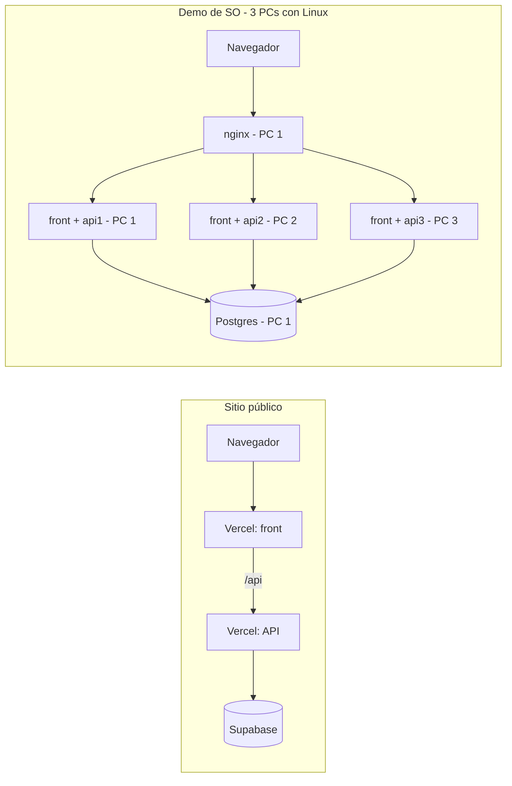

# Infraestructura — dónde corre cada cosa

Decidido el 2026-10-27. Reemplaza el esquema del 2026-10-22 (Postgres propio expuesto a internet y migración desde Supabase), que se descartó:
la consigna de Sistemas Operativos no lo pide y era la parte más riesgosa. Ahora hay **dos despliegues independientes**.

> Los pasos concretos y la lista de humo están en [plan-despliegue.md](plan-despliegue.md). La demo de SO, en el [plan de SO](../sistemas-operativos/plan.md).

## 1. Los dos despliegues

| | Sitio público | Demo de Sistemas Operativos |
| --- | --- | --- |
| Para qué | Que el sitio esté online | Cumplir la consigna de SO |
| Front | Vercel (proyecto 1, build de Vite) | 3 réplicas en contenedores, una por PC |
| API | Vercel (proyecto 2, Express como función serverless) | 3 réplicas en contenedores, una por PC |
| Base | **Supabase** (vía web) | **Postgres dockerizado** en la PC de acceso |
| Balanceo | Lo hace Vercel | **nginx** en la PC de acceso |
| Sistema | — | Linux (VMs) en las 3 PCs |

El código es el mismo en los dos: [db.js](../../api-eventos/src/data/db.js) usa `DATABASE_URL` (Supabase, con SSL) si existe y las `DB_*` si no.
Los compose de Docker no pasan `DATABASE_URL`, así que las réplicas usan siempre el Postgres del contenedor.

El Postgres dockerizado también es donde se desarrolla el [data warehouse](../base-de-datos/data-warehouse.md) (esquema `dw`, en local).

## 2. Variables de entorno en Vercel

| Proyecto | Variable | Valor |
| --- | --- | --- |
| api-eventos | `DATABASE_URL` | La URL de **sesión** de Supabase |
| api-eventos | `JWT_SECRET`, `JWT_EXPIRA` | Texto largo aleatorio (distinto del de desarrollo) y `8h` |
| api-eventos | `DB_POOL_MAX` | `3` |
| api-eventos | `FRONTEND_URL` | La URL de Vercel del front (para CORS) |
| api-eventos | `GMAIL_USUARIO`, `GMAIL_CLAVE_APP` | Opcionales |
| front-eventos | `VITE_API_URL` | La URL de Vercel de la API, terminada en `/api` |

El front necesita un `vercel.json` con un *rewrite* de todo a `index.html`, porque React Router maneja las rutas del lado del cliente
(sin eso, recargar `/empresa/eventos` da 404). Ya está en el repo.

## 3. Variables en la demo de SO

Van en el `.env` de la raíz de cada PC (ver [.env.example](../../.env.example)): datos de la base y `JWT_SECRET` (**el mismo en las 3 PCs**).
`IP_PC1`, `IP_PC2`, `IP_PC3` e `INSTANCIA` tienen un valor por defecto escrito en los compose; se cambian en el `.env` o en el comando (`INSTANCIA=api2 docker compose …`).

## 4. Decisiones pendientes

1. **Cuál es la PC de acceso** (nginx + base, además de su front y api1): la VM de Salma con Linux, según el plan de SO.
2. **Cuenta de Vercel:** ¿la del grupo o la de una persona?
