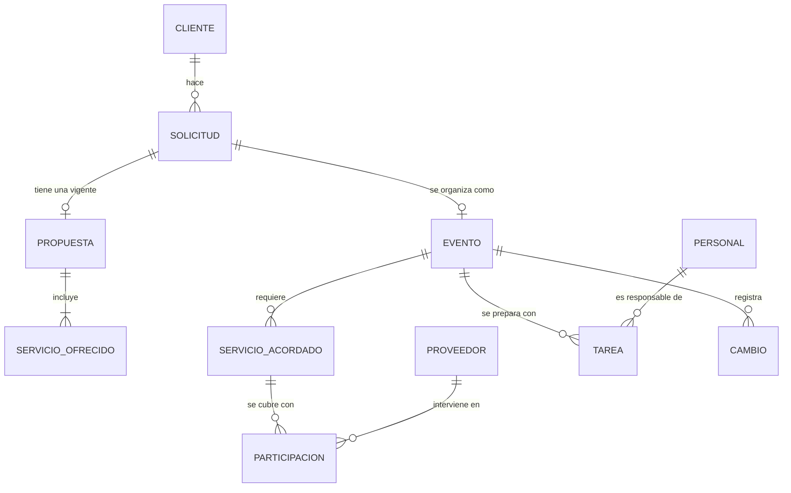
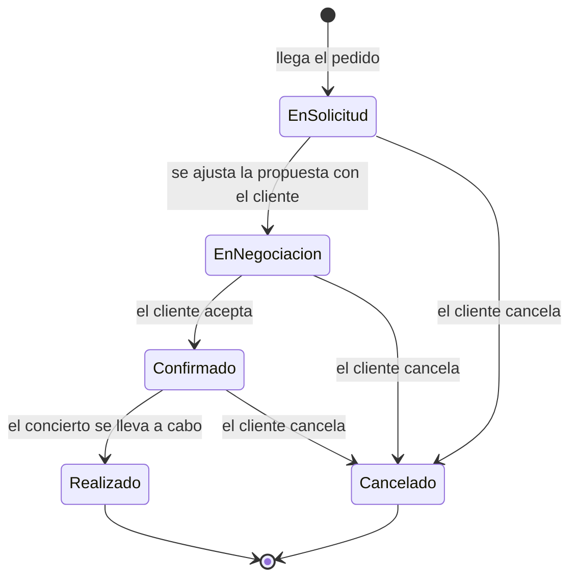

# Análisis — Versión 1

**Estado:** versión 1, en revisión. **Fuente:** [entrevista del 13/10/2026](../relevamiento/entrevista-1-2026-10-13.md).
**Alcance de referencia:** [Objetivo y alcance del software](../consigna.md#2-objetivo-y-alcance-del-software).

Cómo leerlo:

- **[F#]** remite a un hecho relevado (sección 1). Todo lo que se afirma del negocio tiene un F detrás.
- **[D#]** es una duda abierta (sección 5): algo que el cliente no dijo o dejó ambiguo. No se resuelve suponiendo.
- **(interpretación)** marca una decisión nuestra como analistas, que se apoya en los hechos pero no la dijo el cliente.

---

## 1. Hechos relevados

| # | Hecho | Pregunta de origen |
| --- | --- | --- |
| F01 | Backstage organiza conciertos y espectáculos musicales en vivo **por encargo de clientes** | A qué se dedica |
| F02 | Los eventos son de escala pequeña o mediana y de una sola jornada | A qué se dedica |
| F03 | Los clientes pueden ser empresas, instituciones o particulares | A qué se dedica |
| F04 | La disponibilidad de los proveedores se consulta directamente con ellos; Backstage registra lo que le informan | A qué se dedica |
| F05 | **Coordinación de eventos:** recibe los pedidos, arma la propuesta, coordina los servicios y hace el seguimiento general | Quiénes trabajan |
| F06 | **Producción:** prepara el evento, coordina con los proveedores y controla que compromisos y tareas estén encaminados | Quiénes trabajan |
| F07 | **Administración:** mantiene los datos de clientes y proveedores y sigue la información acordada, en especial presupuestos y confirmaciones | Quiénes trabajan |
| F08 | Todos pueden necesitar consultar información de los eventos, pero cada uno se ocupa de su área | Quiénes trabajan |
| F09 | Clientes y proveedores no usan el sistema: la comunicación es por fuera y se registra lo acordado | Quiénes trabajan |
| F10 | Del pedido se registra: contacto del cliente (nombre y medios), tipo de evento, fecha prevista, sede prevista si ya la tiene, asistentes estimados, necesidades y preferencias | Trato con el cliente |
| F11 | No hay formulario rígido: los datos faltantes se completan en conversaciones posteriores | Trato con el cliente |
| F12 | La propuesta se arma con los servicios que responden al pedido; cada servicio tiene un importe y se calcula el total | Armado de la propuesta |
| F13 | Durante la negociación el cliente puede pedir agregar, quitar o modificar servicios; se ajusta la **propuesta vigente** y se vuelven a comunicar los importes | Armado de la propuesta |
| F14 | Se registra si el cliente acepta o rechaza. Si rechaza, se registra el motivo cuando lo comunica | Si no acepta |
| F15 | La propuesta se considera rechazada cuando el cliente comunica que no la acepta. Si pide cambios, se sigue negociando | Validación ⚠ |
| F16 | Si no hay acuerdo, la solicitud queda sin confirmación y se conserva lo registrado | Si no acepta |
| F17 | Cuando el cliente acepta la propuesta, el **encargo** queda confirmado y se registra lo acordado. Lo registra el personal; no hay contratación electrónica | Recorrido, validación ⚠ |
| F18 | Las condiciones acordadas son: fecha, sede, cantidad de asistentes, servicios contratados, sus importes y cualquier condición o necesidad particular | Validación ⚠ |
| F19 | Que el encargo esté confirmado no significa que los proveedores lo estén: eso se verifica y registra después | Validación ⚠ |
| F20 | Para cada servicio se contacta a un proveedor y se le consulta si puede en la fecha. Si puede, su participación queda confirmada; si no, se busca otro. Mientras no haya uno confirmado, el servicio queda pendiente | Proveedores |
| F21 | De cada proveedor se necesita: nombre o razón social, contacto, servicio que presta, condiciones del servicio que comunique y, por evento, si su participación está pendiente o confirmada | Proveedores ⚠ |
| F22 | Tareas de preparación: confirmar servicios con proveedores, coordinar los detalles de su participación, revisar que los servicios acordados estén cubiertos, controlar los pendientes y seguir los cambios que afecten compromisos | Tareas |
| F23 | Las tareas las asigna Coordinación, según quién lleva cada parte del evento. No hay asignación automática | Tareas |
| F24 | La fecha prevista la define quien organiza la tarea, según la fecha del concierto y cuándo tiene que estar resuelto cada asunto | Tareas |
| F25 | Una tarea que llega a su fecha sin terminar se considera "pendiente o vencida según corresponda" | Tareas |
| F26 | Los cambios los registra quien coordina el evento. Después revisa qué compromisos quedaron afectados (tareas internas, servicios coordinados con proveedores) y actualiza su situación a mano | Cambios |
| F27 | La cancelación puede ocurrir en cualquier momento antes de que el evento se realice. La comunica el cliente; se registra con su motivo y se conserva la información | Cancelación |
| F28 | Las consecuencias económicas de una cancelación no se gestionan | Cancelación |
| F29 | Al realizarse el concierto se registra que fue realizado y se dejan observaciones. No hay cierre económico ni evaluación | Cierre |
| F30 | Estados del evento: **En solicitud** (hay pedido, se trabaja en la propuesta), **En negociación** (se ajusta la propuesta, todavía no aceptada), **Confirmado** (aceptada; empieza la preparación), **Realizado**, **Cancelado** | Situaciones del evento |
| F31 | No todos pueden modificar todo. Coordinación trabaja con solicitudes, propuestas y confirmaciones; Producción, con tareas y seguimiento de proveedores. Los permisos tienen que ser sencillos | Permisos |
| F32 | Problemas actuales: la información está repartida; ante un cambio cuesta saber qué compromisos se afectan y avisar a los responsables; cuesta ver tareas pendientes y vencidas y servicios sin confirmar; con varios eventos a la vez hay olvidos | Dificultades |
| F33 | Lo más importante para el cliente: que después de un cambio quede claro **qué se acordó, qué cambió y qué queda pendiente**, y poder consultar eventos por fecha o estado | Cierre de la entrevista |

> ⚠ Estos intercambios se hicieron en el chat pero **no están en la [transcripción](../relevamiento/entrevista-1-2026-10-13.md#validación-falta-pegar)**. Hay que pegarlos para que el hecho tenga respaldo.

---

## 2. Sistema organizacional

### 2.1 Sistema observado y propósito

**Sistema:** la organización de conciertos por encargo en Backstage, desde que llega un pedido hasta que el evento se realiza o se cancela (interpretación, a partir de F01 y del recorrido).

**Propósito:** que cada concierto encargado se realice según lo acordado con el cliente, con todos los servicios cubiertos y las tareas resueltas a tiempo [F01, F22].

### 2.2 Límite y entorno

| Dentro del sistema | En el entorno |
| --- | --- |
| Coordinación, Producción y Administración [F05–F07] | **Clientes:** encargan, negocian, aceptan, rechazan, piden cambios y cancelan [F03, F13, F27] |
| Pedidos, propuestas, encargos confirmados, tareas y el registro de proveedores | **Proveedores:** informan si pueden participar y prestan el servicio [F04, F20] |
| | **Sede** del evento: es un dato que trae el cliente [F10] |

El límite pasa por la comunicación: clientes y proveedores **no entran** al sistema; lo que entra es el resultado de hablar con ellos [F09] (interpretación).

Quedan afuera, porque el cliente lo dijo: consecuencias económicas de la cancelación [F28], cierre económico y evaluación del evento [F29].

### 2.3 Actores y responsabilidades

| Actor | Responsabilidad | Respaldo |
| --- | --- | --- |
| Coordinación de eventos | Recibe pedidos, arma y negocia propuestas, asigna tareas, registra cambios, sigue el evento en general | F05, F23, F26 |
| Producción | Prepara el evento, trata con los proveedores, controla tareas y compromisos | F06 |
| Administración | Mantiene datos de clientes y proveedores; sigue presupuestos y confirmaciones | F07 |
| Cliente (externo) | Origina el pedido y decide sobre la propuesta, los cambios y la cancelación | F13, F14, F27 |
| Proveedor (externo) | Informa su disponibilidad y presta un servicio | F20 |

Pendiente: quién registra la confirmación, la cancelación y el cierre, porque el cliente dijo "el personal de Backstage" sin precisar [D7].

### 2.4 Elementos y relaciones

- Un **cliente** hace un **pedido** [F10].
- Para un pedido se arma una **propuesta**, compuesta por **servicios** con importe [F12].
- La propuesta aceptada define el **encargo confirmado** y sus condiciones [F17, F18].
- Cada servicio del evento necesita un **proveedor** con participación confirmada [F20].
- La preparación se organiza en **tareas** con responsable y fecha prevista [F23, F24].
- Un **cambio** afecta tareas y servicios ya coordinados [F26].

### 2.5 Entradas, procesos y salidas

| Entradas | Procesos | Salidas |
| --- | --- | --- |
| Pedido del cliente [F10] | 1. Registro del pedido | Propuesta para el cliente [F12] |
| Pedidos de cambio a la propuesta [F13] | 2. Armado y negociación de la propuesta | Encargo confirmado, con lo acordado [F17] |
| Aceptación o rechazo [F14] | 3. Confirmación del encargo | Consultas a proveedores [F20] |
| Respuesta de los proveedores [F20] | 4. Coordinación de proveedores | Evento realizado, con observaciones [F29] |
| Cambios de fecha o de servicios [F26] | 5. Preparación y seguimiento de tareas | Evento cancelado, con motivo [F27] |
| Aviso de cancelación [F27] | 6. Tratamiento de cambios | |
| | 7. Cierre o cancelación | |

### 2.6 Subsistemas

(interpretación, según cómo el cliente reparte el trabajo en F05–F07)

- **Comercial:** del pedido a la propuesta aceptada o rechazada. Lo lleva Coordinación.
- **Preparación:** del encargo confirmado al evento realizado: proveedores, tareas y cambios. Participan Producción y Coordinación.
- **Soporte administrativo:** datos de clientes y proveedores. Lo lleva Administración.

### 2.7 Restricciones e interdependencias

- No se prepara un evento que no fue aceptado: la preparación empieza con la confirmación [F30].
- La fecha del concierto condiciona las fechas de las tareas [F24] y la disponibilidad de cada proveedor [F20].
- Un servicio no está resuelto hasta que un proveedor confirma [F20]. Backstage depende de respuestas que no controla.
- Un cambio de fecha o de servicio obliga a revisar tareas y proveedores [F26].
- El equipo es chico y lleva varios eventos a la vez [F32].

### 2.8 Reservas, bucles y demoras

**Reservas** (lo que se acumula y hay que vigilar):
- Eventos en preparación al mismo tiempo [F32].
- Tareas pendientes y vencidas de cada evento [F25].
- Servicios sin proveedor confirmado [F20].

**Bucles:**
- **Negociación:** propuesta → pedido de cambios → ajuste → nueva presentación. Se corta con la aceptación o el rechazo [F13, F15].
- **Búsqueda de proveedor:** consulta → no puede → se busca otro. Se corta cuando uno confirma [F20].
- **Control de pendientes:** revisar pendientes → actuar → quedan menos. Es el bucle que hoy falla, porque los pendientes no se ven a tiempo [F32].
- **Cambio:** un cambio reabre compromisos que estaban resueltos y los devuelve al control de pendientes [F26].

**Demoras:**
- Entre presentar la propuesta y la respuesta del cliente [F13].
- Entre consultar a un proveedor y su respuesta [F20].
- Entre el primer contacto y tener todos los datos del pedido [F11].
- Entre que ocurre un cambio y que los responsables se enteran. Es el problema que el cliente más remarca [F32, F33].

---

## 3. Sistema de información

### 3.1 Información, responsables y finalidad

| Información | Fuente | Quién la registra o modifica | Quién la consulta | Para qué |
| --- | --- | --- | --- | --- |
| Datos de contacto del cliente | Cliente | Coordinación la recibe [F05]; Administración la mantiene [F07] | Todos [F08] | Operar |
| Pedido: tipo, fecha, sede, asistentes, necesidades | Cliente | Coordinación [F05, F31] | Todos | Operar |
| Propuesta: servicios, importes, total | Coordinación, a partir del pedido | Coordinación [F05, F31] | Administración, que sigue presupuestos [F07] | Operar y controlar |
| Aceptación o rechazo, con motivo | Cliente | Coordinación [F31] | Administración [F07] | Controlar y decidir si se prepara |
| Condiciones acordadas | Propuesta aceptada | Coordinación [F31] | Producción, para preparar [F06] | Operar |
| Datos del proveedor | Proveedor | Administración [F07] | Producción [F06] | Operar |
| Participación del proveedor: pendiente o confirmada | Proveedor | Producción [F31] | Coordinación, en el seguimiento [F05] | Controlar |
| Tareas: responsable, fecha prevista, situación | Coordinación las asigna [F23] | Producción [F31] | Coordinación | Operar y controlar |
| Cambios de fecha o servicio | Cliente | Quien coordina el evento [F26] | Responsables de las tareas y servicios afectados | Controlar |
| Cancelación y motivo | Cliente | Personal de Backstage [D7] | Todos | Dejar constancia |
| Realización y observaciones | Personal de Backstage | Personal de Backstage [D7] | Todos | Dejar constancia |
| Estado del evento | Se desprende de lo anterior | — | Todos, para ver qué requiere atención [F33] | Controlar y decidir prioridades |

Falta precisar qué modifica Administración [D2].

### 3.2 Canales y destinatarios

- **Con clientes y proveedores:** conversaciones por fuera del sistema [F09]. El cliente no dijo por qué medios.
- **Dentro de Backstage:** hoy la información está repartida [F32]. El cliente no dijo dónde la guarda cada uno.

### 3.3 Problemas de calidad de la información y controles

Los problemas son los que contó el cliente. Los controles son **propuestas nuestras para validar** (interpretación).

| Problema relevado | Qué falla | Control propuesto |
| --- | --- | --- |
| La información está repartida [F32] | No hay una versión única ni actualizada | Un solo registro por evento, con todo lo acordado |
| Ante un cambio no se sabe qué se afecta [F32, F33] | No hay relación visible entre el cambio y los compromisos | Al registrar un cambio, mostrar las tareas y servicios del evento para revisarlos |
| No queda claro qué se acordó y qué cambió [F33] | Se pierde el dato anterior | Registrar cada cambio con qué cambió y cuándo [D6] |
| Cuesta ver pendientes y vencidos [F32] | La situación de las tareas no se ve de un vistazo | Lista de tareas pendientes y vencidas, y de servicios sin confirmar |
| Olvidos con varios eventos a la vez [F32] | No hay vista del conjunto | Consulta de eventos por fecha y por estado [F33] |
| Preparar algo que no se acordó | — | No permitir tareas ni proveedores en un evento que no está confirmado [F30] |
| Datos incompletos del pedido [F11] | Los datos llegan de a poco | Permitir completar después, y definir qué es obligatorio para avanzar [D4] |

### 3.4 Qué cubre el software y qué queda afuera

| Lo hace una persona, fuera del software | Lo que se registra en el software |
| --- | --- |
| Conversar con el cliente y entender el pedido [F09, F11] | El pedido y los datos del cliente |
| Decidir qué servicios ofrecer y a qué importe [F12] | La propuesta vigente y su total |
| Negociar con el cliente [F13] | Los ajustes a la propuesta y la aceptación o el rechazo |
| Buscar proveedores y consultarles la disponibilidad [F04, F20] | Si cada participación está pendiente o confirmada |
| Decidir quién hace cada tarea y para cuándo [F23, F24] | Las tareas, sus responsables, fechas y situación |
| Analizar qué afecta un cambio [F26] | El cambio y la situación actualizada de los compromisos |
| Realizar el concierto | Que se realizó, con observaciones; o que se canceló, con motivo |

El software **no decide ni resuelve nada por su cuenta**: no cotiza, no asigna y no reprograma [F23, F24, F26]. Centraliza lo acordado y muestra qué falta [F33].

---

## 4. Dominio

### 4.1 Lenguaje ubicuo

| Término | Significado para Backstage | Respaldo |
| --- | --- | --- |
| **Pedido / Solicitud** | Lo que el cliente pide para organizar un concierto. Son sinónimos | Validación ⚠ |
| **Evento** | El concierto que se organiza a partir de una solicitud | Validación ⚠ |
| **Encargo** | El evento una vez que el cliente aceptó la propuesta | F17 |
| **Propuesta** | Servicios ofrecidos con sus importes y el total | F12 |
| **Propuesta vigente** | La versión actual de la propuesta, que se ajusta al negociar | F13 |
| **Servicio** | Lo que se ofrece y se presta en el evento: sonido, iluminación, etc. | F12, F20 |
| **Condiciones acordadas** | Fecha, sede, asistentes, servicios, importes y condiciones particulares | F18 |
| **Proveedor** | Quien presta un servicio en un evento | F20, F21 |
| **Participación** | La intervención de un proveedor en un evento: pendiente o confirmada | F20 |
| **Tarea** | Trabajo interno de preparación, con responsable y fecha prevista | F22–F24 |
| **Compromiso** | Lo que tiene que cumplirse para el evento: tareas y servicios con proveedores | F26, F33 |
| **Cambio** | Modificación de la fecha o de un servicio después de confirmar | F26 |

**Términos ambiguos que hay que cuidar:**

- **"Confirmado"** se usa con dos significados. Un *evento confirmado* es uno cuya propuesta aceptó el cliente. Una *participación confirmada* es un proveedor que dijo que puede. El cliente mismo lo aclara: una cosa no implica la otra [F19].
- **"Pendiente"** se usa para un servicio sin proveedor confirmado [F20] y para una tarea sin terminar [F25].
- **"Evento"** se usa desde que hay un pedido: el primer estado del evento es "En solicitud" [F30]. Falta saber si un pedido rechazado también cuenta como evento [D1].

### 4.2 Modelo conceptual

Es un modelo de conceptos, no de tablas. Dudas que lo pueden modificar: si solicitud y evento son una sola cosa con estados [D1], y si un cambio conserva el dato anterior [D6].

### 4.3 Estados del evento

Los cinco estados son los que nombró el cliente [F30], y la cancelación desde cualquiera anterior a "Realizado" sale de F27.
No figura la propuesta rechazada porque el cliente no le dio un estado [D1], ni el paso exacto de "En solicitud" a "En negociación" [D8].

### 4.4 Reglas de negocio relevadas

| # | Regla | Respaldo |
| --- | --- | --- |
| R1 | Hay una sola propuesta vigente por solicitud; los cambios se hacen sobre ella | F13 |
| R2 | El total de la propuesta es la suma de los importes de sus servicios | F12 |
| R3 | La propuesta se rechaza solo cuando el cliente lo comunica; pedir cambios no es rechazar | F15 |
| R4 | El evento se confirma cuando el cliente acepta la propuesta | F17 |
| R5 | La preparación empieza con la confirmación | F30 |
| R6 | Un servicio está pendiente mientras no tenga un proveedor con participación confirmada | F20 |
| R7 | Que el evento esté confirmado no implica que sus proveedores lo estén | F19 |
| R8 | Las tareas las asigna Coordinación | F23 |
| R9 | Un evento se puede cancelar en cualquier momento antes de realizarse | F27 |
| R10 | Al cancelar se registra el motivo y se conserva toda la información | F27 |
| R11 | Si no hay acuerdo, la solicitud se conserva | F16 |
| R12 | Cada área modifica solo lo que le corresponde; la consulta es más amplia | F31 |

### 4.5 Subdominios y Bounded Contexts

Propuesta inicial del grupo (interpretación), para discutir en la devolución.

| Contexto | Qué resuelve | Subdominio | Por qué se separa |
| --- | --- | --- | --- |
| **Propuestas** | Del pedido a la propuesta aceptada o rechazada | De soporte | Acá "servicio" es **lo que se ofrece, con un importe**. Lo trabaja Coordinación [F31] |
| **Preparación** | Proveedores, tareas, cambios, pendientes y cierre | **Central** | Acá "servicio" es **un compromiso a cubrir**, con un proveedor pendiente o confirmado. Lo trabaja Producción [F31]. Es donde están los problemas que el cliente quiere resolver [F32, F33] |
| **Acceso del personal** | Identificar a cada persona y qué puede modificar | Genérico | No es particular de Backstage |

La separación entre Propuestas y Preparación responde a tres cosas del relevamiento: el término **"servicio" cambia de significado**, cambia **quién modifica la información** [F31], y el propio cliente marca la **confirmación** como el punto donde empieza otra etapa [F30].

La relación entre los dos contextos es la aceptación: lo que en Propuestas es la propuesta aceptada, en Preparación son las condiciones acordadas [F17, F18].

---

## 5. Dudas abiertas

Cada una tiene su pregunta en la [guía de la segunda entrevista](../relevamiento/preguntas-entrevista-2.md).

| # | Duda | Por qué importa |
| --- | --- | --- |
| D1 | Cómo queda una solicitud cuya propuesta fue rechazada | No hay estado para ese caso [F30], y el alcance pide demostrarlo |
| D2 | Qué puede modificar Administración | Hay ejemplos de Coordinación y Producción, no de Administración [F31] |
| D3 | Qué diferencia una tarea pendiente de una vencida, y qué otras situaciones tiene una tarea | "Pendiente o vencida según corresponda" no alcanza para definir los estados [F25] |
| D4 | Qué datos tienen que estar definidos para presentar una propuesta y para confirmar | La sede se registra "si ya la tiene" [F10] |
| D5 | Si los servicios se arman a medida o hay combinaciones habituales, y cómo se define el importe | El alcance lo menciona como particularidad a descubrir |
| D6 | Qué pasa con lo acordado cuando hay un cambio después de confirmar | El cliente quiere ver "qué se acordó y qué cambió" [F33] |
| D7 | Quién registra la confirmación, la cancelación y el cierre | El cliente dijo "el personal de Backstage" |
| D8 | Qué marca el paso de "En solicitud" a "En negociación" | Los dos estados se describen parecido [F30] |
| D9 | Si Backstage puede cancelar un evento por su cuenta | Solo se habló de la cancelación que comunica el cliente [F27] |
| D10 | Si el responsable de una tarea es una persona o un área | Define cómo se consulta "quién debe hacer qué" |

---

## 6. Cobertura contra el alcance

| Área del alcance | Estado | Falta |
| --- | --- | --- |
| Clientes y solicitudes | Relevado | D4 |
| Propuesta y presupuesto | Relevado | D5 |
| Aceptación y rechazo | Relevado a medias | D1 |
| Confirmación del encargo | Relevado | D7 |
| Servicios y proveedores | Relevado | — |
| Preparación y seguimiento | Relevado a medias | D3, D10 |
| Cambios relevantes | Relevado a medias | D6 |
| Cancelación | Relevado | D9 |
| Consulta y cierre | Relevado | D7 |
| Estados | Relevado a medias | D1, D8 |
| Permisos del personal | Relevado a medias | D2 |
