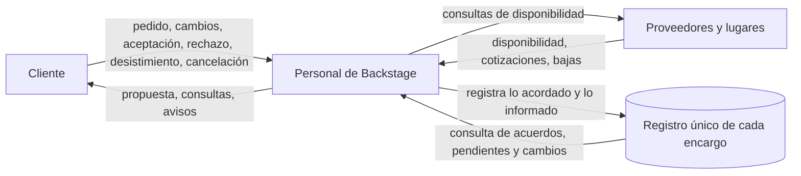
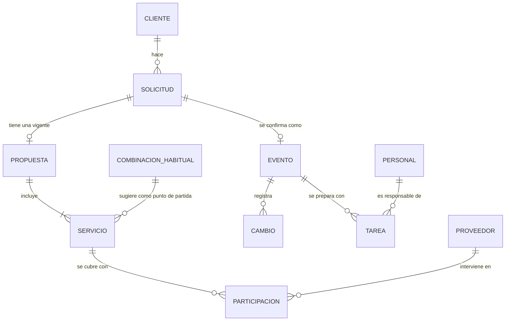
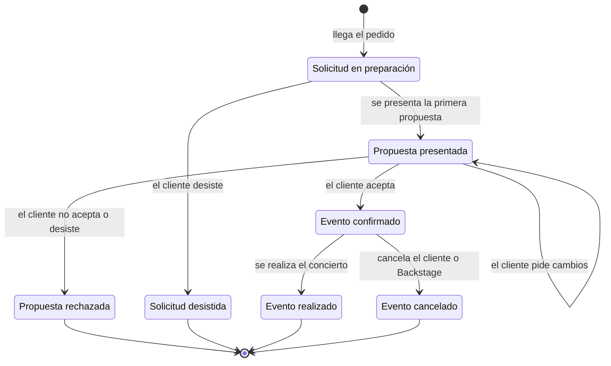

# Análisis, versión 2

Estado: versión 2, a partir de las dos entrevistas. Fuentes: [entrevista 1](../relevamiento/entrevista-1-2026-10-13.md) (13/10/2026, se cita E1 §n) y [entrevista 2](../relevamiento/entrevista-2-2026-10-14.md) (14 y 28/10/2026, se cita E2 §n).
Alcance de referencia: [objetivo y alcance del software](../consigna.md#2-objetivo-y-alcance-del-software). La [versión 1](analisis-v1.md) se conserva sin cambios como evidencia de la evolución.

Cómo leerlo:

- [F#] remite a un hecho relevado (sección 1). F01 a F33 están en la v1; F34 a F68 son nuevos y están en esta versión.
- [D#] es una duda abierta (sección 8). No se resuelve suponiendo.
- (interpretación) marca una decisión nuestra como analistas. Se apoya en los hechos, pero el cliente no la dijo.
- (hipótesis) marca algo que usamos para avanzar y que todavía no se confirmó.

---

## 0. Cambios respecto de la versión 1

| Parte de la v1 | Qué cambia | Por qué |
| --- | --- | --- |
| Estados del evento (v1 §4.3) | Pasan de cinco a siete. Aparecen los cierres antes de confirmar: propuesta rechazada y solicitud desistida. "En solicitud" y "en negociación" se reemplazan por "solicitud en preparación" y "propuesta presentada" | El cliente eligió los nombres nuevos por ser "más claros para el seguimiento cotidiano" [F61]. La negociación es todo el período con la propuesta presentada [F39] |
| Cancelación (F27, R9, R10) | Solo se cancela un evento confirmado. Antes se decía "en cualquier momento antes de realizarse" | El cliente separó rechazo, desistimiento y cancelación [F38, F60] |
| Entorno: la sede (v1 §2.2) | Se corrige. La v1 decía que la sede es un dato que trae el cliente, y nunca se preguntó. La sede la puede traer el cliente o buscarla Backstage; en ese caso va en la propuesta como un servicio con importe | [F58] |
| Quién registra (v1 §2.3, §3.1, D7) | Aceptación y rechazo: Administración. Cancelación y realización: Coordinación, con información de Producción. Administración también registra las respuestas de los proveedores | [F50, F53] |
| Permisos (F31) | Los permisos se reparten por tipo de dato y no por área estricta | [F50] |
| Tarea vencida (F25) | "Vencida" pasa a ser una condición que se calcula con la fecha, no un estado. La tarea conserva su estado | [F62] |
| Servicio (v1 §4.1, §4.5) | La v1 sostenía que "servicio" cambia de significado entre propuesta y preparación. El cliente lo ve como un solo compromiso visto desde dos lados. Cambia la justificación de los Bounded Contexts | [F66, F67] |
| Modelo conceptual (v1 §4.2) | Se agregan la participación con observación, el cambio con dato anterior, nuevo y motivo, la fecha prevista de resolución del servicio, el estado y la observación de la tarea, y la combinación habitual | [F44, F46, F56, F42] |
| Reglas (v1 §4.4) | De 12 pasan a 24 | Sección 4.4 |
| Controles de calidad (v1 §3.3) | Se vuelven concretos y con respaldo: datos mínimos, bloqueo de la confirmación, separación entre confirmado y pendiente, nada se borra | Sección 3.4 |
| Dudas (v1 §5) | D1 a D10 quedan cerradas (sección 8.2). Aparecen cinco dudas nuevas, D11 a D15 | |
| Faltaban en la v1 | Información por actor, flujos de información, escenarios de los recorridos y matriz de permisos | Secciones 3.2, 3.3, 5 y 5.6 |

Lo que se mantiene: el propósito, el límite en la comunicación, las tres áreas, las reglas de la propuesta vigente, la separación entre evento confirmado y proveedores confirmados, y la idea de que el software centraliza lo acordado sin decidir nada por su cuenta.

---

## 1. Hechos relevados

### 1.1 Correcciones a los hechos de la v1

| Hecho | Qué pasó |
| --- | --- |
| F25 (tarea vencida) | Se precisa en F62: la tarea sigue en su estado y además está vencida |
| F27 (cancelación en cualquier momento) | Se corrige en F38: solo se cancela un evento confirmado |
| F30 (cinco estados) | Se reemplaza por F61: siete estados |
| F31 (permisos) | Se amplía en F50: Administración también registra participaciones, aceptación y rechazo |
| F10 (sede prevista "si ya la tiene") | Sigue vigente. Se completa con F58 |
| F15, F17, F18, F19, F21 | Quedaron con respaldo en la entrevista 2 (E2 §1, §3, §12, E1 §7b) |

### 1.2 Hechos nuevos de la entrevista 2

| # | Hecho | Origen |
| --- | --- | --- |
| F34 | Mientras se negocia se modifica la propuesta vigente, sin necesidad de conservar el historial completo de versiones | E2 §1 |
| F35 | "Pedido" y "solicitud" se usan como lo mismo | E2 §1, §2 (implícito) |
| F36 | Las áreas necesitan compartir la información actualizada y mantener centralizada la información de cada encargo | E2 §1 |
| F37 | Un pedido rechazado queda cerrado sin concretarse. Se conservan los datos del cliente, la solicitud y la propuesta presentada. Si el cliente vuelve, es un pedido nuevo | E2 §2 |
| F38 | El rechazo ocurre antes de aceptar la propuesta. La cancelación ocurre cuando el evento ya estaba confirmado | E2 §2, §19 |
| F39 | El pedido pasa a negociación al presentar la primera propuesta. Si el cliente acepta sin cambios, pasa directo a confirmado | E2 §3 |
| F40 | Para presentar una propuesta hacen falta: contacto del cliente, tipo de evento, fecha y sede previstas (pueden ser tentativas), asistentes estimados y necesidades principales | E2 §4 |
| F41 | Para confirmar hacen falta: propuesta aceptada, fecha definida y sede definida. Si falta alguna, se sigue trabajando la solicitud y la propuesta | E2 §4, §27 |
| F42 | Hay combinaciones habituales de servicios. Se usan como punto de partida y no están centralizadas. Les serviría iniciar una propuesta desde una. No quieren selección ni precios automáticos | E2 §5, §11 |
| F43 | Los importes se fijan con los costos conocidos y las cotizaciones de los proveedores. Se revisan en cada propuesta | E2 §5, §11 |
| F44 | Ante un cambio relevante se deja constancia del dato anterior, el nuevo y el motivo si se conoce. No se necesita un historial exhaustivo | E2 §6 |
| F45 | La revisión de las tareas y los proveedores afectados por un cambio es manual. Les serviría ver las tareas y los servicios con sus proveedores al registrar el cambio | E2 §6, §14 |
| F46 | Estados de una tarea: pendiente, en curso, completada y cancelada | E2 §7 |
| F47 | Una tarea que deja de ser necesaria se cancela con una observación del motivo. No se borra y no cuenta como pendiente | E2 §7 |
| F48 | Marca la tarea como completada su responsable. Coordinación también puede si el responsable le avisa | E2 §7 |
| F49 | El responsable de una tarea es una persona concreta. Coordinación puede reasignarla. La tarea conserva estado y fecha, y se deja observación si es relevante | E2 §8 |
| F50 | Administración mantiene datos de clientes y proveedores (contacto y servicios que ofrecen), registra la participación de los proveedores cuando responden, registra la aceptación o el rechazo del cliente y puede actualizar una propuesta si Coordinación acordó el cambio. No asigna ni organiza tareas: avisa a Coordinación | E2 §9 |
| F51 | Backstage puede cancelar un evento, aunque no es lo habitual, si no consigue proveedor para un servicio indispensable después de buscar reemplazo. No toda falta de confirmación implica cancelar | E2 §10 |
| F52 | Al aceptar quedan registrados servicios, importes, fecha, sede, asistentes estimados (como estimación acordada) y condiciones particulares. Pueden cambiar después, como cambio registrado | E2 §12 |
| F53 | Coordinación registra la cancelación y la realización. La realización se registra cuando Producción confirma que el concierto se hizo; Producción aporta las observaciones | E2 §13 |
| F54 | Nada se borra: rechazos, desistimientos, cancelaciones, tareas canceladas y antecedentes de proveedores se conservan con su motivo u observación | E2 §2, §7, §13, §15, §19 |
| F55 | Si un proveedor confirmado se baja, se registra que ya no se cuenta con él, el servicio vuelve a pendiente y queda una observación. Producción informa y Coordinación busca reemplazo | E2 §15 |
| F56 | Un servicio tiene un estado (pendiente mientras no haya proveedor confirmado) y una fecha prevista de resolución. Si pasa sin resolverse es un compromiso atrasado. Sigue pendiente y no se cancela solo | E2 §16 |
| F57 | Que un servicio sea indispensable se determina al preparar la propuesta y conversar con el cliente. No hay clasificación: lo decide el equipo caso por caso | E2 §17 |
| F58 | La sede la puede traer el cliente o buscarla Backstage. Si la gestiona Backstage va en la propuesta como servicio con importe. Se comunica con la sede quien coordina el evento | E2 §18 |
| F59 | Una sede elegida no está necesariamente confirmada para la fecha. Hay que registrar qué está acordado y qué sigue pendiente | E2 §18, §27 |
| F60 | Si el cliente desiste antes de que se presente la propuesta, se cierra como solicitud desistida. Se conservan la solicitud y el motivo si lo informó. No es un evento cancelado | E2 §19, §20 |
| F61 | Los siete estados son: solicitud en preparación, propuesta presentada, propuesta rechazada, solicitud desistida, evento confirmado, evento realizado y evento cancelado | E2 §20, §26 |
| F62 | El vencimiento no reemplaza el estado de la tarea. Una tarea pendiente o en curso que pasó su fecha sigue en su estado y además está vencida. Una finalizada tarde queda finalizada. Nada se cambia automáticamente | E2 §21 |
| F63 | Si cambia la fecha y hay que volver a consultar a un proveedor confirmado, su participación vuelve a pendiente hasta que responda. Solo si el cambio afecta su disponibilidad | E2 §22 |
| F64 | Antes de confirmar se consulta a proveedores sin que eso sea un compromiso. Las tareas, los responsables y el seguimiento formal de proveedores corresponden al evento confirmado | E2 §23 |
| F65 | Se necesitan dos consultas de pendientes: la general de todos los eventos en preparación (Coordinación) y el detalle de cada evento (Producción, que también usa la general) | E2 §24 |
| F66 | El servicio es el mismo compromiso con el cliente, visto primero como oferta con importe y después como algo a cubrir. No quieren dos registros desconectados. Un servicio puede requerir más de un proveedor | E2 §25 |
| F67 | La solicitud y la propuesta forman la etapa comercial. La confirmación da inicio al seguimiento operativo formal | E2 §26 |
| F68 | Se registran la fecha y la sede previstas o acordadas, "según corresponda", y se mantiene identificada la confirmación que falta | E2 §27 |

---

## 2. Sistema organizacional

### 2.1 Sistema observado y propósito

Sistema: la organización de conciertos por encargo en Backstage, desde que llega un pedido hasta que el evento se realiza o se cancela, incluidos los pedidos que se cierran antes de concretarse [F01, F37, F60] (interpretación a partir del recorrido).

Propósito: que cada concierto encargado se realice según lo acordado con el cliente, con todos los servicios cubiertos y las tareas resueltas a tiempo [F01, F22, F33].

### 2.2 Límite y entorno

| Dentro del sistema | En el entorno |
| --- | --- |
| Coordinación, Producción y Administración [F05 a F07] | Clientes: encargan, negocian, aceptan, rechazan, desisten, piden cambios y cancelan [F03, F13, F38] |
| Solicitudes, propuestas, eventos confirmados, tareas y el registro de proveedores | Proveedores: informan si pueden participar, cotizan y prestan el servicio [F04, F20, F43] |
| | Lugar del concierto (la sede). Aporta su disponibilidad y condiciones. Si la gestiona Backstage, funciona como un proveedor más [F58, F59] |

El límite pasa por la comunicación. Clientes, proveedores y lugares no entran al sistema; lo que entra es el resultado de hablar con ellos [F09] (interpretación).

Queda afuera porque el cliente lo dijo: las consecuencias económicas de la cancelación [F28] y el cierre económico y la evaluación del evento [F29].

Por la consigna, el análisis se limita a lo que interviene en el software. Por eso no se analizan cómo se negocia con el cliente, cómo se busca una sede o un proveedor, cómo se cotiza ni cómo se consulta la disponibilidad. Ocurren en la organización, pero fuera del software, y solo importa su resultado [F04, F43, F58].

### 2.3 Actores y responsabilidades

| Actor | Responsabilidad | Respaldo |
| --- | --- | --- |
| Coordinación de eventos | Recibe pedidos, arma y negocia propuestas, asigna y reasigna tareas, registra cambios, hace el seguimiento general, busca reemplazo de proveedores, registra la cancelación y la realización | F05, F23, F26, F49, F53, F55 |
| Producción | Prepara el evento, trata con los proveedores, controla tareas y compromisos, informa bajas de proveedores, confirma a Coordinación que el concierto se hizo y aporta observaciones | F06, F53, F55 |
| Administración | Mantiene datos de clientes y proveedores, registra la aceptación o el rechazo y las respuestas de los proveedores, puede actualizar una propuesta si Coordinación acordó el cambio, y avisa a Coordinación lo que afecte la preparación | F07, F50 |
| Cliente (externo) | Origina el pedido y decide sobre la propuesta, los cambios y la cancelación | F13, F38 |
| Proveedor y lugar (externos) | Informan su disponibilidad, cotizan y prestan un servicio. Un mismo proveedor puede participar en varios eventos | F20, F21, F58 |

### 2.4 Elementos y relaciones

- Un cliente hace una solicitud [F10, F35].
- Para una solicitud se arma una propuesta vigente, compuesta por servicios con importe. Puede partir de una combinación habitual [F12, F42].
- La propuesta aceptada confirma el encargo y define las condiciones acordadas [F17, F18, F52].
- Cada servicio acordado necesita uno o más proveedores con participación confirmada [F20, F66].
- La preparación se organiza en tareas, cada una con una persona responsable y una fecha prevista [F23, F24, F49].
- Un cambio relevante afecta tareas y servicios ya coordinados [F26, F44].

### 2.5 Entradas, procesos y salidas

| Entradas | Procesos | Salidas |
| --- | --- | --- |
| Pedido del cliente [F10] | 1. Registro del pedido | Propuesta presentada al cliente [F12] |
| Pedidos de cambio a la propuesta [F13] | 2. Armado y presentación de la propuesta | Pedido cerrado sin concretarse: propuesta rechazada o solicitud desistida [F37, F60] |
| Aceptación, rechazo o desistimiento [F14, F60] | 3. Negociación | Encargo confirmado con lo acordado [F17, F52] |
| Respuestas y bajas de los proveedores [F20, F55] | 4. Confirmación del encargo | Consultas a proveedores [F20] |
| Cambios de fecha o de servicios [F26] | 5. Coordinación de servicios y proveedores | Evento realizado, con observaciones [F29] |
| Aviso de cancelación del cliente [F38] | 6. Preparación y seguimiento de tareas | Evento cancelado, con motivo [F38, F51] |
| Falta de proveedor para un servicio indispensable [F51] | 7. Tratamiento de cambios | |
| | 8. Cierre o cancelación | |

### 2.6 Subsistemas

(interpretación, según cómo el cliente separa las etapas [F67])

- Comercial: del pedido a la propuesta aceptada, rechazada o desistida. Lo lleva Coordinación y Administración registra la aceptación y el rechazo.
- Preparación y seguimiento: del encargo confirmado al evento realizado o cancelado. Intervienen Producción, Coordinación y Administración.
- Soporte administrativo: datos de clientes y proveedores. Lo lleva Administración.

Los subsistemas no coinciden con las áreas. Administración y Coordinación trabajan en más de uno.

### 2.7 Restricciones e interdependencias

- No se confirma sin propuesta aceptada, fecha definida y sede definida [F41].
- No se prepara formalmente lo que no está confirmado: las tareas y el seguimiento de proveedores empiezan con la confirmación [F64].
- La fecha del concierto condiciona las fechas de las tareas y la disponibilidad de cada proveedor [F24, F63].
- Un servicio no está resuelto hasta que un proveedor confirma. Backstage depende de respuestas que no controla [F20, F59].
- Un servicio indispensable sin cubrir puede llevar a cancelar el evento [F51].
- Un cambio de fecha o de servicio obliga a revisar tareas y proveedores [F26, F45].
- El equipo es chico y lleva varios eventos a la vez [F32].

### 2.8 Reservas, bucles y demoras

Reservas (lo que se acumula y hay que vigilar):

- Eventos en preparación al mismo tiempo [F32].
- Tareas pendientes, en curso y vencidas de cada evento [F62].
- Servicios sin proveedor confirmado y compromisos atrasados [F56].

Bucles:

- Negociación: propuesta presentada, pedido de cambios, ajuste, nueva presentación. Se corta con la aceptación o el rechazo [F13, F39].
- Búsqueda de proveedor: consulta, no puede o se baja, se busca otro. Se corta cuando uno confirma o, si el servicio es indispensable y no hay reemplazo, con la cancelación del evento [F20, F51, F55].
- Cambio de fecha: el cambio devuelve a pendiente la participación de los proveedores afectados, que vuelven a consultarse [F63].
- Control de pendientes: revisar pendientes, actuar, quedan menos. Es el bucle que hoy falla porque los pendientes no se ven a tiempo [F32, F65].

Demoras:

- Entre presentar la propuesta y la respuesta del cliente [F13].
- Entre consultar a un proveedor y su respuesta, incluso la del lugar [F20, F59].
- Entre el primer contacto y tener todos los datos del pedido [F11].
- Entre que ocurre un cambio y que los responsables se enteran. Es el problema que el cliente más remarca [F32, F33].
- Entre la fecha prevista de resolución de un servicio y su cobertura real [F56].

---

## 3. Sistema de información

### 3.1 Quién produce, registra, consulta o modifica cada información

| Información | Fuente | Quién la registra o modifica | Responsabilidad |
| --- | --- | --- | --- |
| Datos de contacto del cliente | Cliente | Coordinación al recibir el pedido; Administración los mantiene y actualiza [F05, F50] | Que estén completos para poder presentar la propuesta [F40] |
| Solicitud: tipo, fecha y sede previstas, asistentes, necesidades | Cliente | Coordinación [F05, F10] | Completarla en las conversaciones posteriores [F11] |
| Propuesta vigente: servicios, importes, total | Coordinación, a partir del pedido y de las cotizaciones | Coordinación la arma y la modifica; Administración puede actualizarla si Coordinación acordó el cambio [F12, F50] | Que refleje lo que se le ofrece a ese cliente [F42] |
| Aceptación o rechazo, con motivo | Cliente | Administración [F50] | Dejar constancia de la decisión |
| Desistimiento, con motivo | Cliente | No relevado [D13] | Dejar constancia |
| Condiciones acordadas | Propuesta aceptada | Se registran al aceptar [F52] | Que quede claro qué aceptó el cliente |
| Datos del proveedor y servicios que ofrece | Proveedor | Administración [F50] | Mantenerlos actualizados |
| Participación del proveedor: pendiente o confirmada, con observación | Proveedor | Administración registra las respuestas; Producción informa las bajas; Coordinación busca reemplazo [F50, F55] | No dar por cubierto lo que no está confirmado |
| Servicio acordado: estado y fecha prevista de resolución | Coordinación y Producción | Quién define la fecha no está relevado [D13, D15] | Detectar compromisos atrasados [F56] |
| Tareas: responsable, fecha prevista, estado, observación | Coordinación las asigna [F23, F49] | El responsable actualiza el estado; Coordinación también puede, reasigna y cancela [F48, F49] | Que cada tarea tenga una persona a cargo |
| Cambios: dato anterior, nuevo y motivo | Cliente | Coordinación [F26, F44] | Saber qué se acordó y qué cambió [F33] |
| Cancelación y motivo | Cliente o Backstage | Coordinación [F53] | Dejar constancia |
| Realización y observaciones | Producción confirma y aporta observaciones | Coordinación [F53] | Dejar constancia |
| Estado de la solicitud o del evento | Se desprende de lo anterior | Cambia con cada registro de la tabla | Mostrar qué requiere atención [F33] |

Todos pueden consultar la información de los eventos, aunque cada área se ocupa de la suya [F08].

### 3.2 Información que necesita cada actor y para qué

| Actor | Operar | Controlar | Decidir |
| --- | --- | --- | --- |
| Coordinación | Datos del pedido, propuesta y condiciones acordadas; tareas por asignar | Tareas pendientes, en curso o vencidas y servicios sin proveedor, de todos los eventos en preparación [F65] | A qué evento intervenir primero, qué tareas siguen teniendo sentido tras un cambio, si se cancela por falta de un servicio indispensable [F47, F51, F65] |
| Producción | Tareas asignadas, proveedores que participan y condiciones del evento | Qué falta resolver para que cada concierto esté listo; pendientes de varios eventos para organizar su trabajo [F65] | Cómo ordenar su trabajo entre eventos (interpretación) |
| Administración | Datos de clientes y proveedores; propuesta para actualizarla | Importes, servicios y estado de la propuesta; aceptaciones y respuestas de proveedores [F50] | No se relevaron decisiones propias |
| Personal en general | Qué se acordó con el cliente | Qué cambió y qué falta confirmar [F33, F36] | Qué eventos requieren atención, consultando por fecha o estado [F33] |

### 3.3 Fuentes, canales y destinatarios

- Con clientes y proveedores, la comunicación se hace por fuera del software [F09]. El cliente no dijo por qué medios.
- Dentro de Backstage hoy la información está repartida [F32]. El cliente no dijo dónde guarda cada uno lo suyo.
- Con el software, el personal registra el resultado de esas conversaciones en un registro único de cada encargo [F36] (el software es el destino del registro).
- Los destinatarios de lo registrado son los tres sectores. Cada sector consulta lo que necesita para su trabajo [F08, F65].

### 3.4 Calidad de la información y controles

Los problemas son los que contó el cliente. Los controles son propuestas de diseño que se apoyan en hechos relevados (interpretación).

| Problema | Qué puede fallar | Control |
| --- | --- | --- |
| La información está repartida [F32, F36] | No hay una versión única ni actualizada | Un registro por encargo que reúna lo acordado, los cambios y los compromisos |
| Datos incompletos del pedido [F11] | Se presenta una propuesta sin base | Permitir completar después, pero exigir contacto, tipo, fecha y sede previstas, asistentes y necesidades principales para presentar la propuesta [F40] |
| Confirmar sin tener lo necesario | Se prepara un evento sin fecha, sede o aceptación | No permitir pasar a evento confirmado sin propuesta aceptada, fecha definida y sede definida [F41] |
| Tomar por asegurado lo que no está confirmado | Una fecha tentativa, una sede elegida o un proveedor sin respuesta se leen como compromiso firme | Mantener separadas la confirmación del evento, la de la sede y la de cada proveedor, y mostrar lo pendiente [F19, F59, F68] |
| No queda claro qué se acordó y qué cambió [F33] | Se pierde el dato anterior | Registrar cada cambio relevante con dato anterior, dato nuevo y motivo si se conoce [F44]. Registrar las condiciones al aceptar [F52] |
| Ante un cambio no se sabe qué se afecta [F32] | No hay vínculo visible entre el cambio y los compromisos | Al registrar un cambio, mostrar las tareas y los servicios con sus proveedores para que el personal decida cuáles se afectan [F45] |
| Cuesta ver pendientes y vencidos [F32] | La situación no se ve de un vistazo | Consulta general de pendientes y consulta por evento [F65]. Marcar como vencida la tarea y como atrasado el servicio con la fecha prevista pasada [F56, F62] |
| Preparar algo que no se acordó | Tareas y proveedores en una solicitud sin confirmar | Cargar tareas y seguimiento formal de proveedores solo desde la confirmación [F64] |
| Pérdida de antecedentes | Se borra lo que explica qué pasó | No borrar. Conservar rechazos, desistimientos, cancelaciones, tareas canceladas y bajas de proveedores con motivo u observación [F54] |
| Una tarea cancelada sigue contando como pendiente | Se distorsiona la lista de pendientes | Excluir las tareas canceladas de los pendientes [F47] |
| Tarea sin responsable claro | Nadie se ocupa | Exigir una persona como responsable de cada tarea [F49] |
| Alguien modifica lo que no le corresponde [F31] | Datos inconsistentes | Permisos por tipo de dato, sencillos (sección 5.6) |

El motivo de un rechazo, un desistimiento o un cambio se registra "si se conoce" [F37, F44]. Por eso no se plantea como dato obligatorio. La cancelación sí lleva motivo [F27].

### 3.5 Qué cubre el software y qué queda afuera

| Lo hace una persona, fuera del software | Lo que se registra en el software |
| --- | --- |
| Conversar con el cliente y entender el pedido [F09, F11] | El pedido y los datos del cliente |
| Decidir qué servicios ofrecer y a qué importe, a partir de la experiencia y de las cotizaciones [F42, F43] | La propuesta vigente, su total y, como ayuda, las combinaciones habituales |
| Negociar con el cliente | Los ajustes a la propuesta y la aceptación, el rechazo o el desistimiento |
| Buscar sede y proveedores y consultarles la disponibilidad [F04, F58] | Si cada participación está pendiente o confirmada, y qué falta confirmar de la sede |
| Decidir quién hace cada tarea y para cuándo [F23, F24] | Las tareas, sus responsables, fechas y estados |
| Decidir si un servicio es indispensable [F57] | (hipótesis) Nada, o una marca simple. Es la duda D12 |
| Analizar qué afecta un cambio [F45] | El cambio con dato anterior, nuevo y motivo, y la situación actualizada de los compromisos |
| Realizar el concierto | Que se realizó, con observaciones; o que se canceló, con motivo |

El software no decide ni resuelve nada por su cuenta. No cotiza, no elige servicios, no asigna tareas, no reprograma ni cancela [F23, F42, F45, F62]. Centraliza lo acordado y muestra qué falta [F33, F36].

---

## 4. Dominio

### 4.1 Lenguaje ubicuo

| Término | Significado para Backstage | Respaldo |
| --- | --- | --- |
| Pedido, solicitud | Lo que el cliente pide para organizar un concierto. Son sinónimos | F35 |
| Solicitud en preparación | Se reúne la información y se arma la propuesta | F61 |
| Propuesta | Servicios ofrecidos con sus importes y el total | F12 |
| Propuesta vigente | La versión actual, que se ajusta al negociar. No se conserva historial de versiones | F13, F34 |
| Propuesta presentada | El cliente tiene la propuesta y se espera su respuesta, incluso si pide cambios | F39, F61 |
| Propuesta rechazada | El cliente recibió la propuesta y no la acepta, o desiste después de recibirla. Cierra la solicitud | F37, F61 |
| Solicitud desistida | El cliente no continúa antes de que se le presente la propuesta | F60 |
| Combinación habitual | Conjunto de servicios que se usa como punto de partida de una propuesta | F42 |
| Servicio | El compromiso con el cliente, visto como oferta con importe y luego como algo a cubrir con proveedores | F66 |
| Servicio indispensable | Servicio sin el cual no se puede hacer el concierto en las condiciones acordadas. Lo decide el equipo | F57 |
| Evento confirmado | La propuesta fue aceptada y hay fecha y sede definidas. Empieza el seguimiento operativo | F41, F61 |
| Condiciones acordadas | Servicios, importes, fecha, sede, asistentes estimados y condiciones particulares | F18, F52 |
| Proveedor | Quien presta un servicio en un evento. Puede ser también el lugar | F20, F58 |
| Participación | La intervención de un proveedor en un evento: pendiente o confirmada | F20 |
| Tarea | Trabajo interno de preparación, con una persona responsable y una fecha prevista | F22 a F24, F49 |
| Compromiso | Lo que tiene que cumplirse para el evento: tareas y servicios con proveedores | F26, F33 |
| Vencida | Condición de una tarea pendiente o en curso cuya fecha prevista pasó | F62 |
| Compromiso atrasado | Servicio pendiente cuya fecha prevista de resolución pasó | F56 |
| Cambio | Modificación de la fecha, la sede o un servicio después de confirmar, con dato anterior, nuevo y motivo | F26, F44 |
| Observación | Nota que explica un motivo o un antecedente (tarea cancelada, proveedor que se baja, cambio de responsable) | F47, F49, F55 |
| Cancelación | Decisión de no realizar un evento ya confirmado, del cliente o de Backstage | F38, F51 |

Términos que cambian de sentido o se mezclan:

- "Confirmado" se usa para tres cosas. Evento confirmado: el cliente aceptó. Participación confirmada: un proveedor dijo que puede. Sede confirmada: el lugar confirmó su disponibilidad para la fecha. Una no implica las otras [F19, F59].
- "Pendiente" se usa para un servicio sin proveedor confirmado, una participación sin respuesta y una tarea sin empezar [F20, F46, F63].
- "Rechazo", "desistimiento" y "cancelación" se separan por el momento: antes de presentar la propuesta, con la propuesta presentada y con el evento confirmado [F38, F60].
- "Vencida" se aplica a tareas y "atrasado" a servicios. Los dos son condiciones que se calculan con una fecha [F56, F62].
- "Completada" (E2 §7) y "finalizada" (E2 §21) parecen nombrar el mismo estado de la tarea (interpretación).
- "Evento" se usa para todo el recorrido, desde la solicitud, pero los estados anteriores a la confirmación se nombran "solicitud" o "propuesta" [F61]. En el modelo se usa solicitud antes de confirmar y evento desde la confirmación (interpretación, ver 4.2).

### 4.2 Modelo conceptual

Es un modelo de conceptos y no de tablas.

| Concepto | Atributos y estados relevados |
| --- | --- |
| Cliente | Nombre y medios de contacto [F10] |
| Solicitud | Tipo de evento, fecha prevista, sede prevista, asistentes estimados, necesidades y preferencias, estado (los seis primeros de F61), motivo de cierre si se conoce [F10, F37, F60] |
| Propuesta | Una vigente por solicitud, total calculado como suma de importes [F12, F34] |
| Servicio | Importe, fecha prevista de resolución y estado pendiente o cubierto desde la confirmación. Puede ser la sede, si la gestiona Backstage [F56, F58, F66] |
| Combinación habitual | Conjunto de servicios de referencia (hipótesis: se guarda como plantilla de propuesta) [F42] |
| Evento | Fecha, sede, asistentes estimados, condiciones particulares y estado (confirmado, realizado, cancelado), observaciones y motivo de cancelación [F52, F53] |
| Participación | Estado pendiente o confirmada y observación [F20, F55] |
| Proveedor | Nombre o razón social, contacto, servicio que presta, condiciones que comunique [F21] |
| Tarea | Responsable (una persona), fecha prevista, estado (pendiente, en curso, completada, cancelada), observación. La condición vencida se calcula [F46, F49, F62] |
| Cambio | Qué cambió, dato anterior, dato nuevo y motivo si se conoce [F44] |
| Personal | Persona del equipo y su área [F49] |

Decisiones de modelado (interpretación):

- Solicitud y evento son dos conceptos unidos por la confirmación. La alternativa es un solo concepto con siete estados. Elegimos separarlos porque el cliente cambia el nombre en ese punto ("solicitud" antes, "evento" después) y porque desde la confirmación aparecen cosas que antes no existen: tareas, seguimiento de proveedores y cambios con constancia [F64, F67].
- El servicio es un único concepto. La propuesta lo incluye como oferta y, una vez aceptada, el servicio de la propuesta es el servicio que hay que cubrir. Así se mantiene la relación que pide el cliente entre lo ofrecido y lo cubierto [F66].
- La sede es un dato de la solicitud y del evento. Cuando Backstage la gestiona, además es un servicio con un proveedor, el lugar [F58].

### 4.3 Estados

Estados de la solicitud y del evento:

| Estado | Quién registra la transición | Regla |
| --- | --- | --- |
| Propuesta presentada | Coordinación (presenta la propuesta) | Hay datos mínimos [F40] |
| Evento confirmado | Administración registra la aceptación [F50] | Propuesta aceptada, fecha definida y sede definida [F41] |
| Propuesta rechazada | Administración registra el rechazo [F50] | Sin propuesta presentada no hay rechazo [F60] |
| Solicitud desistida | No relevado [D13] | Solo antes de presentar la propuesta [F60] |
| Evento realizado | Coordinación, cuando Producción confirma [F53] | Solo desde confirmado |
| Evento cancelado | Coordinación [F53] | Solo desde confirmado [F38] |

Los cambios posteriores a la confirmación (fecha, sede, servicio) no cambian el estado del evento. Se registran como cambios [F44].

Estados de la tarea: pendiente, en curso, completada y cancelada [F46]. Va de pendiente a en curso y a completada. Se puede cancelar mientras no esté completada (interpretación). La condición vencida se suma cuando la fecha prevista pasó y la tarea no está completada ni cancelada [F62].

Estados del servicio acordado: pendiente mientras no tenga un proveedor con participación confirmada, y cubierto cuando lo tiene [F20, F56]. Vuelve a pendiente si el proveedor se baja o hay que reconsultarlo [F55, F63]. La condición atrasado se suma cuando la fecha prevista de resolución pasó y el servicio sigue pendiente [F56]. Con más de un proveedor, cuándo se considera cubierto es la duda D11.

Estados de la participación: pendiente y confirmada [F20]. La baja de un proveedor se registra con una observación y no borra el antecedente [F55].

### 4.4 Reglas de negocio

| # | Regla | Respaldo |
| --- | --- | --- |
| R1 | Hay una sola propuesta vigente por solicitud. Se modifica sin guardar versiones anteriores | F13, F34 |
| R2 | El total de la propuesta es la suma de los importes de sus servicios | F12 |
| R3 | Para presentar una propuesta hacen falta contacto, tipo de evento, fecha y sede previstas, asistentes estimados y necesidades principales | F40 |
| R4 | Al presentar la primera propuesta, la solicitud pasa a propuesta presentada | F39 |
| R5 | Pedir cambios no es rechazar: se ajusta la propuesta vigente y sigue presentada | F15, F39 |
| R6 | Si el cliente no acepta, o desiste con la propuesta ya presentada, queda propuesta rechazada. Se cierra la solicitud, se conserva todo y se anota el motivo si se conoce. Si el cliente vuelve, es un pedido nuevo | F37, F60 |
| R7 | Si el cliente desiste antes de que se presente la propuesta, queda solicitud desistida y se conserva lo registrado | F60 |
| R8 | No se confirma un encargo sin propuesta aceptada, fecha definida y sede definida | F41 |
| R9 | Al confirmar quedan registrados servicios, importes, fecha, sede, asistentes estimados y condiciones particulares | F18, F52 |
| R10 | Que el evento esté confirmado no implica que los proveedores ni la sede lo estén | F19, F59 |
| R11 | Las tareas, los responsables y el seguimiento formal de proveedores corresponden al evento confirmado. Antes solo hay consultas, sin compromiso | F64 |
| R12 | Un servicio está pendiente mientras no tenga proveedor con participación confirmada | F20, F56 |
| R13 | Un servicio pendiente tiene una fecha prevista de resolución. Si pasa, es un compromiso atrasado, sigue pendiente y no se cancela solo | F56 |
| R14 | Cada tarea tiene una persona como responsable. Coordinación asigna y reasigna | F23, F49 |
| R15 | Los estados de la tarea son pendiente, en curso, completada y cancelada. Vencida es una condición que se suma | F46, F62 |
| R16 | Una tarea que deja de ser necesaria se cancela con una observación. No se borra ni cuenta como pendiente | F47 |
| R17 | Un cambio relevante registra el dato anterior, el nuevo y el motivo si se conoce | F44 |
| R18 | Al registrar un cambio el personal revisa a mano los compromisos afectados. El software no reprograma | F26, F45 |
| R19 | Si un proveedor confirmado se baja, o hay que reconsultarlo por un cambio que afecta su disponibilidad, su participación vuelve a pendiente y queda una observación | F55, F63 |
| R20 | Solo se cancela un evento confirmado. Cancela el cliente o Backstage, esta última si no consigue proveedor para un servicio indispensable tras buscar reemplazo | F38, F51 |
| R21 | Coordinación registra la cancelación, con su motivo, y la realización, con observaciones, esta última cuando Producción la confirma | F53 |
| R22 | Nada se borra. Se conservan rechazos, desistimientos, cancelaciones, tareas canceladas y antecedentes de proveedores con su motivo u observación | F54 |
| R23 | Cada área modifica lo que le corresponde por tipo de dato. La consulta es más amplia | F08, F31, F50 |
| R24 | Administración registra la aceptación y el rechazo del cliente | F50 |

### 4.5 Subdominios y Bounded Contexts

Propuesta del grupo (interpretación), para discutir en la devolución.

| Contexto | Qué resuelve | Subdominio | Lenguaje propio |
| --- | --- | --- | --- |
| Comercial | De la solicitud a la propuesta aceptada, rechazada o desistida | De soporte. Es propio de Backstage, pero el cliente ubica sus problemas en otra parte [F32, F33] | Solicitud, propuesta vigente, combinación habitual, aceptación, rechazo, desistimiento |
| Preparación y seguimiento | Del encargo confirmado al evento realizado o cancelado: servicios por cubrir, participaciones, tareas, cambios y pendientes | Central. Ahí están los problemas que el cliente quiere resolver [F32, F33] | Evento, servicio acordado, participación, tarea, cambio, compromiso atrasado, cancelación |
| Acceso del personal | Identificar a cada persona y qué puede modificar | Genérico. No es particular de Backstage | Persona, área, permiso |

Por qué se separan Comercial y Preparación y seguimiento:

1. Por el momento. El cliente marca la confirmación como el punto de cambio: la solicitud y la propuesta son la etapa comercial y la confirmación da inicio al seguimiento operativo formal [F67].
2. Por las reglas. En Comercial la propuesta se modifica sin guardar versiones [F34]. Desde la confirmación, cada cambio exige dato anterior, nuevo y motivo [F44], y recién entonces existen tareas y seguimiento de proveedores [F64].
3. Por el resultado. Comercial puede terminar sin pasar a Preparación, con una propuesta rechazada o una solicitud desistida [F37, F60].
4. Por la pregunta que responde cada uno. Comercial: qué se le ofrece al cliente y si lo aceptó. Preparación: qué falta para que el concierto se haga [F33].

Lo que no justifica la separación:

- Las áreas. Administración trabaja en los dos contextos (registra la aceptación y mantiene los datos de proveedores) y Coordinación también (arma la propuesta y registra los cambios) [F50]. La consigna pide justamente que no haya correspondencia automática entre contextos y sectores.
- El significado de "servicio". El cliente lo ve como un solo compromiso con dos vistas, y no quiere dos registros desconectados [F66]. En el modelo es un único concepto que pasa de un contexto al otro.

Relación entre los contextos: Comercial entrega a Preparación el encargo confirmado, con los servicios y las condiciones acordadas, en el momento de la aceptación [F52]. Preparación conserva el vínculo con lo ofrecido para poder comprobar si cada servicio está cubierto [F66]. Comercial es el contexto de origen y Preparación el que recibe (interpretación).

Datos del cliente y del proveedor: Administración los mantiene [F50]. El cliente pertenece al lenguaje de Comercial y el proveedor al de Preparación. No se plantea un contexto aparte para ellos (interpretación).

Riesgo de esta delimitación: podría sostenerse un solo contexto con siete estados. Elegimos dos por las cuatro razones anteriores, y lo dejamos para revisar con la devolución.

---

## 5. Recorridos que la solución tiene que soportar

### 5.1 Recorrido completo

1. Llega un pedido. Coordinación registra contacto, tipo de evento, fecha y sede previstas, asistentes y necesidades. Estado: solicitud en preparación [F10, F61].
2. Coordinación arma la propuesta, a veces desde una combinación habitual, con servicios e importes y su total. Si la sede la gestiona Backstage, la incluye como servicio [F12, F42, F58].
3. Se presenta la primera propuesta. Estado: propuesta presentada [F39].
4. El cliente pide cambios y Coordinación ajusta la propuesta vigente, o acepta. Administración registra la aceptación [F13, F50].
5. Con fecha y sede definidas, el estado pasa a evento confirmado y quedan registradas las condiciones acordadas [F41, F52].
6. Coordinación y Producción buscan proveedores para cada servicio. Cada participación queda pendiente o confirmada. Coordinación crea las tareas, con persona responsable y fecha prevista [F20, F64].
7. Durante la preparación se consultan los pendientes de todos los eventos y de cada uno [F65].
8. El concierto se realiza. Producción avisa y Coordinación registra la realización con las observaciones. Estado: evento realizado [F53].

### 5.2 Propuesta rechazada

1. La propuesta está presentada y el cliente comunica que no la acepta, con o sin motivo. También se trata así si desiste con la propuesta ya presentada [F37, F60].
2. Administración registra el rechazo y el motivo si se conoce [F50].
3. Estado: propuesta rechazada. La solicitud queda cerrada sin concretarse. No se confirma ni se prepara nada [F37].
4. Se conservan los datos del cliente, la solicitud y la propuesta presentada [F54].
5. Si el cliente vuelve, se registra un pedido nuevo [F37].

Si el cliente desiste antes de que se presente la propuesta, el cierre es "solicitud desistida" y se conserva lo registrado [F60].

### 5.3 Cambio relevante

1. El evento está confirmado y el cliente pide cambiar la fecha [F44].
2. Coordinación registra el cambio con la fecha anterior, la nueva y el motivo si se conoce [F44].
3. En ese momento el software muestra las tareas del evento y sus servicios con proveedores [F45].
4. Coordinación decide a mano qué se afecta. Actualiza fechas de tareas o cancela las que ya no corresponden, con observación [F45, F47].
5. Si el cambio afecta la disponibilidad de un proveedor, su participación vuelve a pendiente hasta que responda [F63].
6. Si el proveedor no puede, el servicio sigue pendiente y se busca reemplazo [F55].
7. El estado del evento no cambia. El cambio queda registrado [F44].

### 5.4 Cancelación

Por el cliente:

1. El evento está confirmado y el cliente comunica que no lo realiza [F38].
2. Coordinación registra la cancelación con el motivo si se conoce. Estado: evento cancelado [F53].
3. Se conserva la información del encargo, los servicios acordados, las tareas y los cambios. Las consecuencias económicas no se gestionan [F28, F54].

Por Backstage:

1. Un servicio indispensable queda sin proveedor. Se busca reemplazo y el servicio sigue pendiente [F51, F55].
2. Si no se logra cubrirlo y no se puede hacer el concierto en las condiciones acordadas, el equipo puede decidir cancelar [F51].
3. Coordinación registra la cancelación indicando que no se consiguió proveedor para ese servicio [F51, F53].

Un pedido que no está confirmado no se cancela: se rechaza o se desiste [F38, F60].

### 5.5 Acceso identificado del personal

1. Cada persona del equipo accede con su identidad y tiene un área [F49, F31].
2. Puede consultar la información de los eventos [F08].
3. Solo modifica los tipos de dato que la matriz de la sección 5.6 le asigna [F31, F50].
4. Cada tarea muestra la persona responsable [F49].

### 5.6 Matriz de permisos

(interpretación a partir de F08, F31, F50, F53 y F55; el cliente pidió permisos sencillos)

| Tipo de dato | Coordinación | Producción | Administración |
| --- | --- | --- | --- |
| Datos de clientes | Registra al recibir el pedido | Consulta | Mantiene y actualiza |
| Solicitud | Modifica | Consulta | Consulta |
| Propuesta | Modifica | Consulta | Actualiza si Coordinación acordó el cambio |
| Aceptación y rechazo | Consulta | Consulta | Registra |
| Datos de proveedores | Consulta | Consulta | Mantiene y actualiza |
| Participación de proveedores | Busca reemplazo; permiso a definir (D13) | Informa bajas y trabaja el seguimiento | Registra las respuestas |
| Tareas | Asigna, reasigna, cancela y actualiza | Actualiza las propias | Consulta; avisa a Coordinación |
| Cambios | Registra | Consulta | Consulta |
| Cancelación y realización | Registra | Aporta información y observaciones | Consulta |

Producción aporta la información de la realización pero no la registra [F53]. Un permiso por persona dentro de cada área no se relevó.

---

## 6. Revisión de coherencia

| Qué se revisa | Resultado |
| --- | --- |
| Propósito y límite | El propósito (concierto realizado según lo acordado, con servicios cubiertos y tareas a tiempo) coincide con el límite: incluye la etapa comercial y la preparación, y deja afuera lo económico |
| Límite y entorno | Clientes, proveedores y lugares están afuera y entran como resultado de conversaciones. La sede se corrigió respecto de la v1 |
| Actores y reglas | Cada regla nombra quién actúa. Los permisos de la sección 5.6 salen de los mismos hechos |
| Procesos y estados | Los ocho procesos de 2.5 corresponden a las transiciones de 4.3. Cada salida de 2.5 es un estado final |
| Subsistemas y contextos | Coinciden en el corte (momento de la confirmación) y no coinciden con las áreas, como se explica en 4.5 |
| Modelo y reglas | Cada concepto del modelo aparece en el lenguaje ubicuo y en alguna regla. Servicio, participación, tarea y cambio tienen estados o atributos relevados |
| Afirmaciones sin respaldo | Las interpretaciones y las hipótesis están marcadas. Ver sección 7 |
| Límite del análisis | No se analizó cómo se negocia, se cotiza o se consulta disponibilidad, porque no interviene en el software |

### 6.1 Cobertura contra el alcance del software

| Área del alcance | Dónde está cubierta | Falta |
| --- | --- | --- |
| Clientes y solicitudes | 3.1, 4.2, R3 | Nada |
| Propuesta y presupuesto | 4.4 R1 a R5, 5.1 | Nada |
| Confirmación del encargo | 4.4 R8 a R10, 5.1 | D14 |
| Servicios y proveedores | 4.3, 4.4 R10 a R13, R19 | D11, D13, D15 |
| Preparación y seguimiento | 4.3, 4.4 R11 a R16, 3.2 | Nada |
| Consulta y cierre | 3.2, 4.4 R20 a R22, 5.4 | Nada |
| Cambios relevantes | 5.3, R17, R18 | Nada |
| Cancelación | 5.4, R20 | Nada |
| Propuesta rechazada | 5.2, R6, R7 | Nada |
| Permisos del personal | 5.5, 5.6 | D13 |

---

## 7. Hipótesis e interpretaciones

| # | Qué es | Sobre qué | Qué lo validaría |
| --- | --- | --- | --- |
| H1 | Hipótesis | Con la sede elegida y su disponibilidad sin confirmar, el evento puede pasar a confirmado dejando la confirmación del lugar como compromiso pendiente. El cliente dijo que "no damos por cerrado el asunto ni confirmamos el evento como si estuviera todo resuelto", y es ambiguo | D14 |
| H2 | Hipótesis | Un servicio con varios proveedores está cubierto cuando todos confirmaron | D11 |
| H3 | Hipótesis | Las combinaciones habituales se guardan como plantilla de propuesta | Pedido del cliente de poder iniciar desde una [F42] |
| H4 | Interpretación | Solicitud y evento son dos conceptos unidos por la confirmación | Revisión con la devolución |
| H5 | Interpretación | "Completada" y "finalizada" son el mismo estado de la tarea | Confirmar con el cliente |
| H6 | Interpretación | Que un servicio sea indispensable es un criterio del equipo y no un dato del sistema | D12 |
| H7 | Interpretación | La sede gestionada por Backstage es un servicio cuyo proveedor es el lugar | Coincide con F58 |
| H8 | Interpretación | Los permisos de 5.6 | F08, F31, F50 |
| H9 | Interpretación | La delimitación en dos contextos más acceso | Revisión con la devolución |

---

## 8. Dudas

### 8.1 Dudas abiertas

| # | Duda | Por qué importa |
| --- | --- | --- |
| D11 | Cuando un servicio requiere más de un proveedor, ¿cuándo se considera cubierto? | Define el estado del servicio y el pendiente |
| D12 | ¿Se anota en el sistema que un servicio es indispensable, o queda como criterio del equipo? | Condiciona la cancelación por Backstage y la vista de pendientes |
| D13 | ¿Quién registra la solicitud desistida, quién define la fecha prevista de resolución de un servicio y quién registra la participación cuando Coordinación busca reemplazo? | Completan la matriz de permisos |
| D14 | Con la sede elegida y su disponibilidad pendiente, ¿se puede marcar el evento como confirmado? ¿Cómo se anota la confirmación que falta? | Define la regla de confirmación en el caso del lugar (H1) |
| D15 | ¿La fecha prevista de resolución es obligatoria para todo servicio? | Define cuándo un servicio puede quedar atrasado |

Ninguna impide escribir el informe. Se pueden cerrar con una entrevista 3 corta o dejar como hipótesis marcadas.

### 8.2 Dudas de la v1 cerradas

| # | Cierre | Dónde |
| --- | --- | --- |
| D1 | Pedido rechazado: queda cerrado sin concretarse, se conserva y, si vuelve, es un pedido nuevo | F37, F61 |
| D2 | Administración: datos, participaciones, aceptación y rechazo; puede actualizar la propuesta | F50 |
| D3 | Estados de la tarea y significado de vencida | F46, F62 |
| D4 | Datos mínimos para presentar y para confirmar | F40, F41 |
| D5 | Combinaciones habituales como punto de partida; importes según costos y cotizaciones | F42, F43 |
| D6 | Los cambios conservan dato anterior, nuevo y motivo | F44 |
| D7 | Aceptación y rechazo: Administración. Cancelación y realización: Coordinación | F50, F53 |
| D8 | El paso a negociación ocurre al presentar la primera propuesta | F39 |
| D9 | Backstage puede cancelar por falta de proveedor de un servicio indispensable | F51 |
| D10 | El responsable de una tarea es una persona | F49 |
