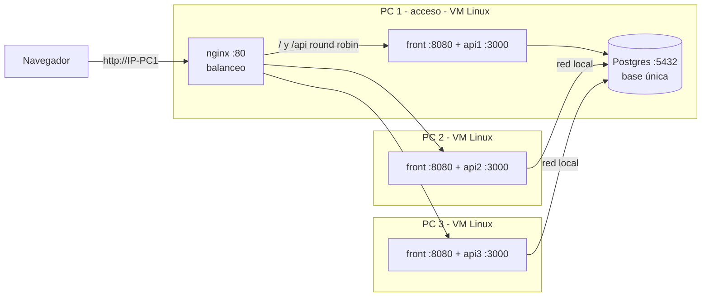

# Sistemas Operativos — resumen y plan del grupo

**Qué evalúa:** el despliegue de la app de Programación 2 **replicada en contenedores**, con **Nginx como balanceador de carga**
en la máquina de acceso y **una única base de datos SQL dockerizada**. Texto completo de la cátedra: [consigna.md](consigna.md).

## 1. Qué hay que mostrar

| Exigencia | Cómo lo mostramos |
| --- | --- |
| **Servicios en Docker:** todos los componentes y réplicas corriendo en contenedores | `docker compose ps` en cada máquina: nginx, las réplicas del front y de la API, y Postgres en estado `running` / `healthy` |
| **Docker Compose:** la infraestructura, las réplicas y la red | Recorrer [docker-compose.app.yml](../../docker-compose.app.yml) (front + back) y [docker-compose.servidores.yml](../../docker-compose.servidores.yml) (nginx + base): servicios, puertos, volumen de la base, variables, y los Dockerfile de [front-eventos](../../front-eventos/Dockerfile) y [api-eventos](../../api-eventos/Dockerfile) |
| **Configuración de Nginx:** el balanceo entre nodos | Recorrer [nginx.conf.template](../../nginx/nginx.conf.template) (los dos `upstream`, `proxy_pass`, reintento si un nodo cae) y mostrarlo funcionando (sección 6) |

## 2. Cómo lo armamos

Decidido por el grupo (2026-10-27): **todo corre en Linux**, en **3 computadoras distintas**, con todo dockerizado.

| Decisión | Detalle |
| --- | --- |
| **Linux en las 3 PCs** | Una **máquina virtual** con Ubuntu Desktop (con interfaz gráfica) en cada PC (VirtualBox), con **Docker Engine** y Claude Code en la terminal |
| **Red de las VMs en "Adaptador puente"** | Con NAT (el valor por defecto) las VMs no se ven entre sí. Con puente, cada VM tiene una IP de la red local |
| **Qué se replica** | El **front** y la **API**: cada PC corre los dos, con el mismo compose ([docker-compose.app.yml](../../docker-compose.app.yml)) |
| **PC de acceso (PC 1)** | Además de su front y api1, corre el segundo compose ([docker-compose.servidores.yml](../../docker-compose.servidores.yml)): **nginx** (único punto de entrada, reparte `/` entre los front y `/api` entre las api) y **Postgres** (la base única, con volumen) |
| **PCs 2 y 3** | Corren solo el compose de la app: un front y una api (api2 y api3), conectada al Postgres de la PC 1 por la red local |
| **La base es un contenedor** | `postgres:17-alpine` dentro de la VM de la PC 1, no un Postgres instalado en el sistema |

## 3. Supabase y la base dockerizada

El sitio público en Vercel sigue usando **Supabase** (la base "vía web"). El Postgres dockerizado es **el de esta demo**
(y el del data warehouse en local). No se expone a internet ni se migra nada: eso se descartó por innecesario para la consigna.
Detalle en [infraestructura.md](../comun/infraestructura.md).

**¿Cómo se elige la base?** Sin tocar código. [db.js](../../api-eventos/src/data/db.js) usa `DATABASE_URL` si existe; si no, las `DB_*`.
Los compose de Docker **no pasan `DATABASE_URL`**, así que las réplicas usan siempre el Postgres del contenedor.

**¿Los scripts SQL corren en el contenedor?** Sí: son SQL estándar de PostgreSQL y las extensiones (`pgcrypto`, `btree_gist`) vienen en la imagen oficial.
El compose monta la carpeta [api-eventos/database/](../../api-eventos/database/) entera en `/docker-entrypoint-initdb.d`, y Postgres corre los `.sql`
**solo la primera vez** (volumen vacío), en orden alfabético. `00_reset.sql` también corre, pero en una base vacía no hace nada. Incluye los seeds `10` y `11`,
así que la demo arranca con lugares, productoras, eventos y ventas.

> **Pendiente de verificar:** ninguno probó todavía los scripts en un Postgres vacío. Es lo primero que hay que hacer (paso 3 de la sección 5).

**Regla:** todo cambio de esquema va en un **script nuevo numerado** (`13_…sql`), nunca editando la base a mano. Para que un script nuevo entre en la base de la demo
hay que recrear el volumen (`docker compose -f docker-compose.servidores.yml down -v`, **solo en la demo**).

## 4. Qué hay en el repo

| Archivo | Qué hace |
| --- | --- |
| `docker-compose.app.yml` | Las 3 PCs: `front` (:8080) y `api` (:3000), con `DB_HOST` apuntando a la IP de la PC 1 |
| `docker-compose.servidores.yml` | Solo PC 1: `db` (Postgres con volumen, los scripts y healthcheck) y `nginx` (imagen oficial con nuestro `.conf`) |
| `nginx/nginx.conf.template` | Un `upstream` de front y otro de api con las 3 IPs, `proxy_pass`, reintento si un nodo cae, log con el nodo que respondió |
| `front-eventos/Dockerfile` | Dos etapas: compila el front con `VITE_API_URL=/api` y sirve solo `dist/` con `serve` (sin `node_modules`) |
| `api-eventos/Dockerfile` | Imagen de la API (`node:24-alpine`, `npm ci --omit=dev`) |
| `.env.example` | Variables: base y `JWT_SECRET`; opcionalmente IPs y nombre de la réplica |

**Las IPs se escriben en un solo lugar:** como valor por defecto en los compose (`${IP_PC1:-192.168.0.10}`). Se pueden pisar desde el `.env` o en el comando
(`IP_PC1=… docker compose …`), sin editar archivos. La imagen oficial de nginx arma su `.conf` desde el template con esas variables.
Son dos compose con `name:` distinto (`backstage-app` y `backstage-servidores`) para que en la PC 1 no se pisen.

## 5. Plan de trabajo

Los comandos de cada paso, desde Windows hasta la demo, están en el [paso a paso](paso-a-paso.md).

| # | Paso | Quién | Estado |
| --- | --- | --- | --- |
| 1 | En cada PC: VirtualBox + VM Ubuntu Desktop (red en "Adaptador puente") + Docker Engine + Claude Code | Cada uno | 🟡 Salma instalando |
| 2 | Archivos Docker en `main`: Dockerfile del front y del back, compose de app y de servidores, nginx con template | | ✅ 2026-10-29 (imagen del front y `.conf` de nginx probados; falta el conjunto) |
| 3 | **Una sola VM:** `docker compose -f docker-compose.servidores.yml up -d` y `docker compose -f docker-compose.app.yml up -d --build`, con las tres IPs iguales a la de esa VM. Verificar que los scripts corren en el Postgres vacío y que la app funciona en `http://IP-VM` | | ⬜ |
| 4 | Ver el balanceo: varios pedidos a `/api/salud` y la respuesta alterna; apagar una réplica y ver que la app sigue | | ⬜ |
| 5 | **Tres PCs:** copiar el repo y el `.env` (mismo `JWT_SECRET`) a cada VM, con las IPs reales y `INSTANCIA`; PC 1: `docker-compose.servidores.yml`; las 3: `docker-compose.app.yml` | Los 3 | ⬜ |
| 6 | Abrir los puertos 80, 8080, 3000 y 5432 si hay firewall (`ufw allow`) y probar `curl http://IP:3000/api/salud` y `curl http://IP:8080` desde otra PC | Los 3 | ⬜ |
| 7 | Ensayo completo con el guion de la sección 6 | Los 3 | ⬜ |
| 8 | Preparar la explicación del compose y del template de nginx para la defensa | Los 3 | ⬜ |

**Plan B (falla la red el día de la demo):** todo en una VM, con las tres IPs iguales a la de esa VM (nginx reparte entre tres veces la misma réplica). Muestra Docker, el compose y el balanceo, pero no las PCs distintas.

El desarrollo de la app sigue contra Supabase como hasta ahora.

## 6. Guion de la demo

1. `docker compose ps` en cada PC: todos los contenedores arriba.
2. Abrir la app desde el navegador apuntando a la PC de acceso y usarla normalmente (login, panel, cartelera).
3. Pedir varias veces `http://IP-PC1/api/salud`: responde una réplica distinta cada vez (`"instancia": "api1"`, `"api2"`, `"api3"`).
   En las herramientas del navegador se ve el header `X-Instancia`.
4. `docker compose -f docker-compose.servidores.yml logs nginx`: cada línea muestra a qué nodo mandó nginx el pedido (`-> 192.168.x.x:3000` o `:8080`).
5. **Tolerancia a fallas:** apagar una réplica (`docker compose -f docker-compose.app.yml stop` en la PC 2) y mostrar que la app sigue funcionando:
   nginx reintenta en otra (`proxy_next_upstream`).
6. Mostrar que la sesión sigue aunque cambie de réplica: el login vive en el token (JWT), no en la memoria de una réplica.
7. Mostrar que hay **una sola base**: un dato que se carga desde una réplica lo ven todas.

## 7. Dudas para el profesor

Ya decidido: Linux en las 3 PCs (VMs), réplicas en PCs físicas distintas, base y nginx en la PC de acceso.

1. **"Una única base de datos … dockerizada (la SQL) y la otra vía web":** ¿"la otra" es una segunda base en la web (Supabase),
   o se refiere a que la aplicación se accede vía web? Hoy lo resolvemos así: la dockerizada es la de la demo y Supabase es la del sitio en Vercel.
2. Docker Compose maneja los contenedores de **una** PC. Con réplicas en PCs distintas, ¿alcanza con **dos compose**
   (app: front + api en las 3 PCs; servidores: nginx + base en la PC 1), o espera **Docker Swarm** (`docker stack deploy`)? Hoy hacemos los dos compose.

## 8. Riesgos y cómo prevenirlos

| Riesgo | Prevención |
| --- | --- |
| La red de la facultad **aísla a los dispositivos** y las VMs no se ven entre sí | Llevar un router o usar el **hotspot de un celular** para las 3 PCs. Ensayar antes |
| La VM está en NAT y las otras PCs no la alcanzan | Adaptador puente en la configuración de red de VirtualBox. Comprobar con `ping` y `curl` entre PCs |
| El **firewall** (`ufw`) bloquea los puertos 80, 8080, 3000 o 5432 | `sudo ufw allow 80,8080,3000,5432/tcp` y probar con `curl http://IP:3000/api/salud` desde otra PC |
| Las IPs de las PCs cambian de un día para otro | Están en un solo lugar (los compose o el `.env`): revisarlas con `ip a` y recrear (`up -d`) antes de la demo. Mejor, IP fija en el router |
| Una réplica con otro `JWT_SECRET` rechaza las sesiones de las demás | El mismo `.env` en las 3 PCs (pasado por privado) |
| Los scripts fallan en el Postgres vacío | Probarlo en el paso 3, bastante antes de la demo |
| Falla la red el día de la demo | Plan B de la sección 5 |
