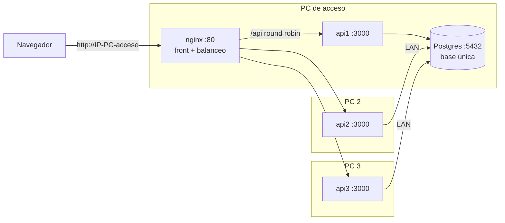

# Sistemas Operativos — resumen y plan del grupo

**Qué evalúa:** el despliegue de la app de Programación 2 **replicada en contenedores**, con **Nginx como balanceador de carga**
en la máquina de acceso y **una única base de datos SQL dockerizada**. Texto completo de la cátedra: [consigna.md](consigna.md).

## 1. Qué hay que mostrar

| Exigencia | Cómo lo mostramos |
| --- | --- |
| **Servicios en Docker:** todos los componentes y réplicas corriendo en contenedores | `docker compose ps` en cada máquina: nginx, las réplicas de la API y Postgres en estado `running` / `healthy` |
| **Docker Compose:** la infraestructura, las réplicas y la red | Recorrer el `docker-compose.yml`: servicios, réplicas, redes, volumen de la base, variables |
| **Configuración de Nginx:** el balanceo entre nodos | Recorrer el `nginx.conf` (`upstream`, `proxy_pass`, reintento si un nodo cae) y mostrarlo funcionando (sección 6) |

## 2. Cómo entendemos la consigna

> "…replicada en distintas máquinas (van a estar en contenedores), utilizando Nginx como balanceador de carga en una máquina
> que va a ser la de acceso y manteniendo una única base de datos exclusiva en una de las instancias que va a estar dockerizada (La SQL)…"

- **Máquina de acceso:** una sola PC. Corre Nginx, que es la única puerta de entrada: sirve el front y reparte `/api` entre las réplicas.
- **Base de datos:** **una sola** Postgres, en un contenedor, en una de las máquinas. Todas las réplicas usan esa misma base.
- **Réplicas de la API:** el mismo backend corriendo varias veces, cada una en su contenedor.
- **"Distintas máquinas" son PCs físicas distintas** (decidido): hay que demostrar que las réplicas corren en las otras PCs del grupo,
  que se conectan a la base de la PC de acceso y que el nginx de esa PC las reconoce y les reparte los pedidos.
- **La base va en la PC de acceso** (decidido): la consigna no lo especifica, y así la PC de acceso concentra la entrada y los datos.

Armamos **dos modos con los mismos archivos**:

| Modo | Para qué | Dónde corre cada cosa |
| --- | --- | --- |
| **Varias PCs** (el de la demo) | Lo que pide la consigna | PC de acceso: nginx + Postgres (+ una réplica). Cada PC del grupo: una réplica |
| **Una PC** | Desarrollar y probar sin depender de la red, y plan B si la red falla el día de la demo | Todo en una PC: nginx + 3 réplicas + Postgres |

### 2.1 Linux y Windows

La materia trabaja con Linux. Docker Desktop en Windows también corre **contenedores Linux** (por dentro usa WSL 2), así que las imágenes
(`postgres`, `nginx`, `node:24-alpine`), el `docker-compose.yml` y el `nginx.conf` son **los mismos** en los dos sistemas. Cambia el entorno:

| | Linux (Docker Engine) | Windows (Docker Desktop) |
| --- | --- | --- |
| Comandos | `docker compose up -d`, `ps`, `logs`: iguales | Iguales |
| Firewall | `ufw`, si está activo | Firewall de Windows: hay que abrir los puertos a mano |
| Puertos hacia la red local | Directo | Docker Desktop los reenvía; el firewall puede bloquearlos |

**Propuesta:** la **PC de acceso** (nginx + base) es la de Salma **con Linux**, porque es la que se muestra en la defensa.
Las PCs con réplicas pueden ser Windows con Docker Desktop. Si el profesor pide Linux en todas, solo cambia la instalación de Docker (duda 2).

## 3. Supabase y la base dockerizada

**¿Es al pedo seguir usando Supabase?** No (decidido: seguimos desarrollando contra Supabase). Es lo que nos deja trabajar a los 3 sobre los
mismos datos sin tener la PC de acceso prendida. La base dockerizada es para **el despliegue y la demo** de esta materia.

**¿Cómo se cambia de una base a la otra?** Sin tocar código. [db.js](../../api-eventos/src/data/db.js) ya elige según el `.env`:

| Variable | Base que usa la API |
| --- | --- |
| `DATABASE_URL` con la URL de Supabase | Supabase (vía web) |
| `DATABASE_URL` vacía y `DB_HOST`, `DB_PORT`, `DB_USER`, `DB_PASSWORD`, `DB_NAME` | El Postgres del contenedor |

**¿Los scripts SQL sirven para la base dockerizada?** Sí, son SQL estándar de PostgreSQL: no usan nada propio de Supabase
(revisado: no hay `auth.`, roles de Supabase ni `GRANT`). Las extensiones que piden (`pgcrypto` y `btree_gist`) vienen en la imagen oficial `postgres`.
Postgres corre automáticamente los `.sql` de `/docker-entrypoint-initdb.d` **la primera vez** que arranca con el volumen vacío, en orden alfabético:

| Script | En Docker |
| --- | --- |
| `00_reset.sql` | **No se monta** (es solo para desarrollo; en una base vacía no hace falta) |
| `01` a `08` | Tablas, triggers y vistas |
| `09_seguridad.sql` | Se corre igual: no molesta (RLS sin políticas; la API entra con el usuario dueño de las tablas) |
| `10` y `11` | Datos de la plataforma y de demo: así la demo arranca con lugares, productoras, eventos y ventas |
| `12_verificacion_email.sql` y los que vengan | Se agregan solos si se monta la carpeta entera |

> **Pendiente de verificar:** ninguno de nosotros probó todavía los scripts en un Postgres vacío. Es lo primero que hay que hacer (paso 1 de la sección 5).

**Regla para no perder el rumbo:** todo cambio de esquema va en un **script nuevo numerado** (`13_…sql`), nunca editando la base a mano.
Así la base de Docker queda igual a la de Supabase con solo volver a crearla.

**¿Y los datos que cargamos en Supabase?** La base dockerizada arranca con los datos de demo de los seeds. Si para la demo queremos los datos
que fuimos cargando en Supabase, se copian una vez con `pg_dump --data-only` desde Supabase y se cargan en el contenedor. Es opcional.

## 4. Qué tenemos y qué falta

En la rama **`docker-nginx`** (Salma, 2026-10-08) está casi todo el modo "una PC":

| Archivo | Qué hace | Estado |
| --- | --- | --- |
| `docker-compose.yml` | nginx, api1/api2/api3, Postgres con volumen y healthcheck, dos redes (`red-front` y `red-datos`) | 🟡 Hay que actualizarlo (ver abajo) |
| `nginx/nginx.conf` | `upstream` round robin, `proxy_pass` de `/api/`, reintento si una réplica cae, log con el nodo que respondió, front de React | ✅ Sirve tal cual para "una PC" |
| `nginx/Dockerfile` | Compila el front con `VITE_API_URL=/api` y lo copia en nginx | ✅ |
| `api-eventos/Dockerfile` | Imagen de la API (`node:24-alpine`) | ✅ |
| `.dockerignore`, `api-eventos/.dockerignore`, `.env.example` | Excluye `node_modules`, `.env`, docs | ✅ / 🟡 falta `JWT_SECRET` en el ejemplo |

Lo que quedó viejo desde el 08/10 (la rama no se mergeó y `main` avanzó mucho):

- El compose monta `database/empresas.sql`, que **ya no existe**: hay que montar los scripts `01` a `12` (sección 3).
- La API ahora **no arranca sin `JWT_SECRET`**, y el compose no se lo pasa. Tiene que ser **el mismo en todas las réplicas**,
  porque un token firmado por una lo valida otra. También faltan `GMAIL_USUARIO` y `GMAIL_CLAVE_APP` (opcionales).
- El `index.js` de esa rama es el viejo: **no hay que traerlo**. `main` ya tiene el header `X-Instancia` y `/api/salud`.
- La rama tiene conflictos con `main`: conviene **copiar los archivos de Docker a `main`** en vez de mergear la rama.

Lo que falta para el modo "varias PCs":

- Un compose para la PC de acceso (nginx + Postgres + api1) y otro para las demás PCs (solo una réplica de la API).
- En la PC de acceso, **publicar el puerto 5432 de Postgres a la red local**, para que lleguen las réplicas de las otras PCs.
- Que el `upstream` de nginx apunte a **las IPs de las PCs** (`192.168.x.x:3000`) en lugar de a nombres de contenedores.
  Conviene no escribirlas a mano en el `nginx.conf`: la imagen oficial de nginx arma el archivo desde un *template* con variables de entorno.

## 5. Plan de trabajo

| # | Paso | Quién | Estado |
| --- | --- | --- | --- |
| 1 | Instalar Docker: **Docker Engine** en la PC de acceso (Linux, Salma) y **Docker Desktop** en las PCs Windows (usa WSL 2) | Cada uno | 🟡 Salma instalando en Linux |
| 2 | Traer a `main` los archivos de la rama `docker-nginx` y actualizarlos: scripts `01`–`12`, `JWT_SECRET`, variables de Gmail | | ⬜ |
| 3 | **Modo una PC:** `docker compose up -d --build`, verificar que los scripts corren en el Postgres vacío y que la app funciona en `http://localhost` | | ⬜ |
| 4 | Ver el balanceo: varios pedidos a `/api/salud` responden `api1`, `api2`, `api3` alternados; apagar una réplica y ver que sigue andando | | ⬜ |
| 5 | **Modo varias PCs:** compose de la PC de acceso y de los nodos, template de nginx con las IPs, puerto 5432 a la red local | | ⬜ |
| 6 | Ensayo con las 3 PCs en la misma red (ver riesgos en la sección 8) | Los 3 | ⬜ |
| 7 | Preparar la explicación del `docker-compose.yml` y del `nginx.conf` para la defensa | Los 3 | ⬜ |

Mientras tanto, el desarrollo de la app sigue contra Supabase como hasta ahora.

## 6. Guion de la demo

1. `docker compose ps` en cada PC: todos los contenedores arriba.
2. Abrir la app desde el navegador apuntando a la PC de acceso y usarla normalmente (login, panel, cartelera).
3. Pedir varias veces `http://IP-acceso/api/salud`: responde una réplica distinta cada vez (`"instancia": "api1"`, `"api2"`, …).
   En las herramientas del navegador se ve el header `X-Instancia`.
4. `docker compose logs nginx`: cada línea muestra a qué nodo mandó nginx el pedido (`-> 192.168.x.x:3000`).
5. **Tolerancia a fallas:** apagar una réplica (`docker compose stop api2` o apagar la PC 2) y mostrar que la app sigue funcionando:
   nginx reintenta en otra (`proxy_next_upstream`).
6. Mostrar que la sesión sigue aunque cambie de réplica: el login vive en el token (JWT), no en la memoria de una réplica.
7. Mostrar que hay **una sola base**: un dato que se carga desde una réplica lo ven todas.

## 7. Dudas para el profesor

Ya decidido: las réplicas van en **PCs físicas distintas** y la base en la **PC de acceso**.

1. **"Una única base de datos … dockerizada (la SQL) y la otra vía web":** ¿"la otra" es una segunda base en la web (por ejemplo Supabase),
   o se refiere a que la aplicación se accede vía web? Mientras tanto seguimos con Supabase para desarrollar; si fuera una base web,
   la API ya la puede usar con solo cambiar `DATABASE_URL`.
2. ¿Hace falta que **todas** las PCs usen Linux, o alcanza con que la de acceso sea Linux y las otras usen Docker Desktop en Windows?

## 8. Riesgos y cómo prevenirlos

| Riesgo | Prevención |
| --- | --- |
| El Wi-Fi de la facultad **aísla a los dispositivos** y las PCs no se ven entre sí | Llevar un router o usar el **hotspot de un celular** para las 3 PCs. Ensayar antes |
| El **firewall de Windows** bloquea los puertos 80, 3000 o 5432 | Abrir esos puertos en las 3 PCs (regla de entrada) y probar con `curl http://IP:3000/api/salud` desde otra PC |
| Las IPs de las PCs cambian de un día para otro | Ponerlas en variables del `.env` (no en el `nginx.conf`) y revisarlas antes de la demo |
| Una réplica con otro `JWT_SECRET` rechaza las sesiones de las demás | El mismo `.env` en las 3 PCs (pasado por privado) |
| Los scripts fallan en el Postgres vacío | Probarlo en el paso 3, bastante antes de la demo |
| Falla la red el día de la demo | Plan B: el modo "una PC". Muestra Docker, el compose y el balanceo, pero no las PCs distintas: es solo para no quedar sin nada |
